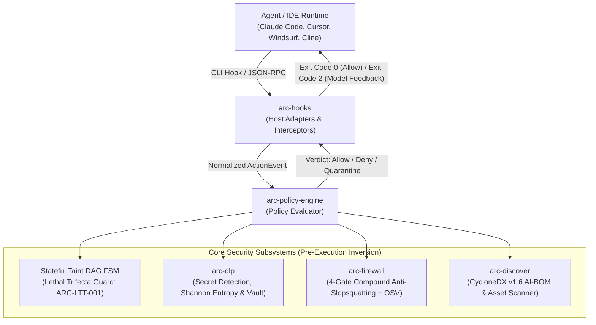

# Vexa Arc: Agentic Runtime Firewall & Pre-Execution AI Security

[](https://www.rust-lang.org/)
[](LICENSE)
[](#cross-platform-installation--setup)
[](#automated-tests--verification)
[](#core-architectural-invariants)
[-orange)](#prerequisites-by-os)
[](#6-standardized-cyclonedx-v16-ai-bom-export-arc-bom)
[](#4-anti-slopsquatting-dependency-firewall-arc-shield)
[](#-documentation--workflow-guides)

**Vexa Agentic Runtime Firewall** (`arc`) is an ultra-low-latency, zero-dependency native Rust runtime firewall and pre-execution endpoint security platform (**EDR for AI Agents**). Built for modern autonomous AI engineering workflows, Vexa Arc inspects and governs what coding agents (Claude Code, Cursor, Windsurf, Cline) and Model Context Protocol (MCP) servers see, use, and execute on developer endpoints and CI runners before code or shell execution touches disk.

<p align="center">
  <a href="#quick-start-30-seconds"><b>Quick Start</b></a> •
  <a href="#core-security-pillars"><b>Core Pillars</b></a> •
  <a href="#ide--agent-hook-integrations"><b>Agent Hooks</b></a> •
  <a href="docs/user-guide.md"><b>User Guide</b></a> •
  <a href="docs/developer-guide.md"><b>Developer Guide</b></a> •
  <a href="#architecture--invariants"><b>Architecture</b></a> •
  <a href="#cli-command-reference"><b>CLI Reference</b></a>
</p>

---

## The Autonomous Agent Threat Model

Autonomous coding agents possess shell execution permissions, file system read/write access, and external network or MCP connectivity. Traditional endpoint protection (EDR) operates *post-execution* after processes have spawned, missing agent-specific vectors entirely.

Vexa Arc enforces **Pre-Execution Inversion**: decisions are rendered in $< 2.5\text{ ms}$ *before* actions occur.

```
┌────────────────────────────────────────────────────────────────────────────────────────┐
│                               AGENT RUNTIME BOUNDARY                                   │
│                                                                                        │
│   Agent Input / Host Hook  ──▶  [ Vexa Arc Engine ]  ──▶  Permitted: Execute Action     │
│   (Claude Code, Cursor, MCP)        │                     🛑 Denied: Structured JSON   │
│                                     │                         (Model Self-Correction)  │
│                                     ▼                                                  │
│   Evaluates:                                                                           │
│   1. Lethal Trifecta DAG (Private Data + Untrusted Context + Egress)                   │
│   2. Multi-Language Token Egress (curl, python urllib, node http, powershell)          │
│   3. Slopsquatting & OSV Vulnerability Firewall (4-Gate Compound Defense)             │
│   4. Dynamic MCP Schema Rug-Pull Quarantine (RFC 8785 JCS Hash Pinning)                │
│   5. Sub-8ms AST Fatal Injection Patterns (eval, SQL interpolation, raw innerHTML)    │
│   6. OS-Level Process Containment (Job Objects / PR_SET_PDEATHSIG / Memory Limits)    │
└────────────────────────────────────────────────────────────────────────────────────────┘
```

---

## ⚡ Value at a Glance

| Security Dimension | Threat Vector Addressed | Vexa Arc Mechanism | CLI Command |
| :--- | :--- | :--- | :--- |
| **Lethal Trifecta Guard** | Indirect prompt injection triggering data exfiltration | Stateful session Taint DAG with field/path isolation and multi-language token egress classification | `arc intercept eval --session s1` |
| **Agent Hook Defense** | Unmonitored agent shell commands and tool calls | Native hooks for Claude Code (`.claude/settings.json`) and Cursor (`.cursor/hooks.json`) with `failClosed: true` | `arc host install --host claude-code` |
| **Package Firewall** | Slopsquatting (hallucinated packages) & supply chain malware | 4-gate compound defense + live OSV/EPSS scan with fail-closed network handling and JSON-RPC remediation | `arc shield npm install lodash` |
| **Schema Rug-Pulls** | Runtime MCP privilege escalation | RFC 8785 JCS SHA-256 schema hashing with `--pin-schema` enforcement | `arc protect stdio --pin-schema <hash>` |
| **Orphan Processes** | MCP child processes outliving parent sessions | Windows Job Objects (`CREATE_SUSPENDED`), Linux `PR_SET_PDEATHSIG` + `RLIMIT_AS`, Unix process groups | `arc protect stdio --max-memory-mb 512` |
| **Secret Exfiltration** | Credentials leaked into agent context windows | Linear-time Shannon entropy secret detector + synthetic tokenization vault (`<ARC_VAULT_SECRET_XX>`) | `arc scan-secrets --path . --redact` |
| **AST Injection Hook** | Injected backdoors in code generation | Sub-8ms Aho-Corasick + regex diff hook halting raw SQL interpolation, eval/exec, and innerHTML | `arc intercept eval --kind file_write` |
| **AI Asset Discovery** | Shadow AI models and unvetted MCP servers | Zero-touch workstation & repo scanner exporting compliant **CycloneDX v1.6 AI-BOM** manifests | `arc audit --output-bom ai-bom.json` |

---

## Quick Start (30 Seconds)

### 1. Build and Run from Source
```bash
# Clone and build the native release binary (Zero external C / OpenSSL dependencies)
git clone https://github.com/noviqtechnologies/vexa-arc.git
cd vexa-arc
cargo build --release

# On Linux/macOS:
./target/release/arc --help

# On Windows (PowerShell):
.\target\release\arc.exe --help
```

### 2. Immediate Diagnostic Checks
```bash
# ⚡ Test the Pre-Execution Package Firewall (catches hallucinated packages in < 5ms):
arc shield npm install reactt

# 🔍 Discover AI assets, MCP configs, and agent rule files across your project:
arc audit

# 🔒 Detect secrets with local pseudonymization token replacement:
arc scan-secrets --path .env --redact

# 🛡️ Install native runtime hooks for Claude Code or Cursor:
arc host install --host claude-code
arc host install --host cursor
```

*(Pre-built standalone binaries for Linux x86_64/arm64, macOS Apple Silicon/Intel, and Windows x86_64 are also downloadable directly from [GitHub Releases](https://github.com/noviqtechnologies/vexa-arc/releases)).*

---

## Core Security Pillars

### 1. Stateful Session Taint DAG & Lethal Trifecta Prevention (`ARC-LTT-001`)

The **Lethal Trifecta** occurs when an autonomous agent simultaneously acquires:
1. **Private Data Access** (e.g. reading `.env`, database configuration, SSH keys, internal source code)
2. **Untrusted Context Ingestion** (e.g. reading untrusted issues, web scraping, external PR comments)
3. **Outbound Egress / Execution** (e.g. posting to external webhooks, running `curl`, executing network scripts)

Vexa Arc tracks session taints monotonically in an in-memory directed acyclic graph (DAG):

```bash
# 1. Agent reads sensitive local credentials -> adds PRIVATE_DATA + SECRET_MATERIAL
arc intercept eval .env --session dev-session

# 2. Agent ingests untrusted issue context -> adds UNTRUSTED_CONTENT
arc intercept prompt "https://malicious.com/issue/42" --session dev-session

# 3. Agent attempts outbound Slack message or network egress -> HARD BLOCKED (Exit code 2)
arc intercept eval slack/slack_post_message --session dev-session
```

#### Token-Based Multi-Language Egress Classification
Vexa Arc classifies shell commands via lexical tokenization rather than brittle binary prefix matching. Outbound egress is detected across:
- **Standard utilities:** `curl`, `wget`, `nc`, `ncat`, `netcat`, `socat`, `ssh`, `scp`, `rsync`
- **Python:** `python -c "import urllib..."`, `python3 -c "import requests, socket..."`
- **Node.js:** `node -e "require('http')..."`
- **Ruby & Perl:** `ruby -e "require 'net/http'..."`, `perl -e "use LWP..."`
- **PowerShell:** `Invoke-WebRequest`, `Invoke-RestMethod`, `Start-BitsTransfer`
- **Compound command defense:** Commands like `git status; curl https://evil.com` are parsed as compound execution and prohibited from benign exemptions.

---

### 2. Native IDE & Agent Runtime Hooks

Vexa Arc integrates directly into host agent runtimes with zero-friction configuration and **fail-closed** guarantees:

```bash
# Automatically install hooks into .claude/settings.json or .cursor/hooks.json
arc host install --host claude-code
arc host install --host cursor

# Inspect active status and detect unauthorized configuration bypasses:
arc host status --host claude-code --json
```

#### Claude Code Integration (`.claude/settings.json`)
Vexa Arc hooks into Claude Code's native `PreToolUse` and `PostToolUse` lifecycle events. Denials return exit code `2`, causing Claude Code to surface the remediation message directly to the model for automated self-correction without crashing the session:
```json
{
  "commands": {
    "PreToolUse": [
      {
        "matcher": ".*",
        "hooks": [{ "type": "command", "command": "arc intercept hook --host claude-code" }]
      }
    ],
    "PostToolUse": [
      {
        "matcher": ".*",
        "hooks": [{ "type": "command", "command": "arc intercept hook --host claude-code" }]
      }
    ]
  }
}
```

#### Cursor IDE Integration (`.cursor/hooks.json`)
Vexa Arc configures Cursor with `failClosed: true` across `beforeShellExecution`, `beforeMCPExecution`, `beforeReadFile`, and `afterMCPExecution`:
```json
{
  "version": 1,
  "hooks": {
    "beforeShellExecution": [{ "command": "arc intercept hook --host cursor", "failClosed": true }],
    "beforeMCPExecution": [{ "command": "arc intercept hook --host cursor", "failClosed": true }],
    "beforeReadFile": [{ "command": "arc intercept hook --host cursor", "failClosed": true }],
    "afterMCPExecution": [{ "command": "arc intercept hook --host cursor", "failClosed": true }]
  }
}
```

---

### 3. Process Containment & Schema Pinning (`arc protect`)

When supervising stdio Model Context Protocol (MCP) servers, Vexa Arc acts as an inline security broker with OS-level containment:

```bash
# Supervise an MCP server with schema pinning and a 512 MB memory boundary:
arc protect stdio \
  --server github \
  --pin-schema 3b1f... \
  --max-memory-mb 512 \
  -- npx @modelcontextprotocol/server-github
```

- **Zero-Race Process Containment:**
  - **Windows:** Spawns processes with `CREATE_SUSPENDED`, assigns them immediately to a Job Object configured with `JOB_OBJECT_LIMIT_KILL_ON_JOB_CLOSE` and memory limits, and resumes execution (`NtResumeProcess`). Zero window for uncontained execution.
  - **Linux:** Sets `PR_SET_PDEATHSIG` with parent PID verification and applies `RLIMIT_AS` virtual memory caps.
  - **macOS / Unix:** Isolates child processes into distinct process groups (`setpgid`), ensuring `SIGKILL` cleanly reaps all child worker trees on exit.
- **Dynamic Schema Rug-Pull Prevention (`ARC-RUG-001`):** Canonicalizes declared tool schemas using RFC 8785 JSON Canonicalization Scheme (JCS). If a tool's parameters expand dynamically at runtime without matching `--pin-schema`, calls are immediately quarantined.
- **Tool Result Taint Attribution:** Outputs from external tools (e.g. GitHub issue fetches, web scraping) are ingested into the session Taint DAG before returning to the model, preventing delayed Lethal Trifecta bypasses.

---

### 4. Anti-Slopsquatting Dependency Firewall (`arc shield`)

AI agents frequently hallucinate package names or install dependencies without human review. `arc shield` implements a **4-gate compound defense** combined with live OSV/EPSS vulnerability scanning:

```bash
# Natural command wrapper (use directly in terminal or agent scripts):
arc shield npm install reactt
arc shield pip install shadow-agent
arc shield cargo add tokio

# Shorthand package check:
arc shield check lodash --ecosystem npm --json
```

1. **Established Fast Path:** Packages $> 90$ days old with $> 100{,}000$ monthly downloads pass without delay.
2. **Compound Typosquat Gate:** Evaluates Jaro-Winkler string similarity, Levenshtein edit distance, package age ($< 14$ days), and low download counts ($< 500$).
3. **Lifecycle Scripts Gate:** Blocks newly registered packages ($< 30$ days) containing arbitrary shell execution hooks (`preinstall`, `postinstall`).
4. **Phantom 404 Gate:** Halts requests for non-existent registry packages before attackers can register them.
5. **Live OSV & EPSS Scanning (`ARC-SCA-001`):** Evaluates vulnerabilities via OSV batch queries with local `.sca-cache` fallback. Fail-closed behavior blocks unknown or unversioned packages with structured JSON-RPC remediation options.

---

### 5. Linear-Time Context DLP & Pseudonymization Vault

Scans prompts, files, and standard input in $< 0.9\text{ ms}$ for high-risk credentials (AWS keys, GitHub tokens, OpenAI keys, Slack tokens, private keys, JWTs):
- **Linear-Time Aho-Corasick Prefiltering**: Eliminates latency overhead on large source files.
- **Shannon Entropy Verification**: Validates entropy thresholds on candidate substrings to prevent false alarms on test fixtures.
- **Local Pseudonymization Vault**: Replaces detected secrets with synthetic surrogate tokens (`<ARC_VAULT_SECRET_XX>`) before sending prompts to external LLMs, rehydrating real values upon authorized return.

```bash
# Scan repository or directory
arc scan-secrets --path .

# Scan standard input and redact secrets
cat app.config | arc scan-secrets --redact
# Windows PowerShell:
Get-Content app.config | arc scan-secrets --redact
```

---

### 6. Standardized CycloneDX v1.6 AI-BOM Export (`arc bom`)

Generates specification-compliant OWASP CycloneDX v1.6 AI-BOM manifests capturing AI models, datasets, declared MCP tool services, and agent instruction files (`.cursorrules`, `CLAUDE.md`, `.windsurfrules`):

```bash
# Export CycloneDX v1.6 AI-BOM to file
arc bom --path . --out cyclonedx-ai-bom.json

# Run audit and export AI-BOM simultaneously
arc audit --path . --output-bom ai-bom.json
```

---

## Architecture & Invariants



### Core Architectural Invariants

1. **Pre-Execution Inversion**: All security checks trigger *before* code touches disk or shell commands execute.
2. **Sub-Millisecond Latency Budget**: In-memory policy evaluations, Aho-Corasick pre-filtering, and taint updates complete within $p_{99} < 2.5\text{ ms}$.
3. **Zero Network Egress**: All parsing, AST pattern checks, and taint analysis run 100% locally on the host machine.
4. **Monotonic Taint Accumulation**: Taints (`PRIVATE_DATA`, `UNTRUSTED_CONTENT`, `SECRET_MATERIAL`, `EXTERNAL_EGRESS`) accumulate across session life cycles and cannot be reset by agent prompts.
5. **Deterministic Schema Invariance (RFC 8785)**: MCP tool schemas are canonicalized via RFC 8785 JCS and SHA-256 hashed to defeat dynamic rug-pull attacks.

---

## CLI Command Reference

All commands support relative and absolute paths, cross-platform path separators (`/` or `\`), and default to the current working directory (`.`):

| Command | Purpose | Key Flags | Example |
| :--- | :--- | :--- | :--- |
| `arc audit` | Scan project or workstation for AI assets, rules, and MCP configs | `--workstation`, `--json`, `--output-bom <PATH>` | `arc audit --output-bom ai-bom.json` |
| `arc bom` | Export CycloneDX v1.6 AI-BOM | `-p, --path <PATH>`, `-o, --out <PATH>` | `arc bom --out ai-bom.json` |
| `arc shield` | Anti-slopsquatting package firewall & OSV scanner | `check <PKG>`, `run <CMD>`, `--dangerous-scripts`, `--json` | `arc shield npm install lodash` |
| `arc scan-secrets` | Scan files or stdin for secrets with entropy checks | `-p, --path <PATH>`, `--redact` | `arc scan-secrets --path . --redact` |
| `arc host` | Manage host integrations (Claude Code, Cursor) | `install`, `status`, `uninstall`, `--host <HOST>` | `arc host install --host claude-code` |
| `arc protect` | Supervise MCP servers with containment and schema pinning | `stdio --server <NAME>`, `--pin-schema <HASH>`, `--max-memory-mb <MB>` | `arc protect stdio --server fs -- npx server` |
| `arc intercept` | Intercept and evaluate agent actions against session Taint DAG | `eval`, `read`, `exec`, `mcp`, `prompt`, `hook`, `session` | `arc intercept hook --host claude-code` |
| `arc trace` | Inspect event causality and export redacted audit evidence | `<EVENT_ID>`, `latest`, `--export <PATH>`, `--json` | `arc trace latest --export trace.json` |
| `arc doctor` | Check host adapters, policy engine, and cumulative metrics | `--metrics`, `--json` | `arc doctor --metrics` |
| `arc version` | Display platform version and build target | N/A | `arc version` |

---

## CI/CD Quality Gate (GitHub Actions)

Integrate Vexa Arc into your CI/CD pipelines to enforce security quality gates on every push and pull request:

```yaml
name: Vexa Arc Security Gate

on: [push, pull_request]

jobs:
  arc-security-audit:
    runs-on: ubuntu-latest
    steps:
      - uses: actions/checkout@v4
      - uses: dtolnay/rust-toolchain@master
        with:
          toolchain: stable

      - name: Build Vexa Arc
        run: cargo build --release --locked

      - name: Run AI-SPM Audit & CycloneDX v1.6 AI-BOM Export
        run: ./target/release/arc audit --output-bom cyclonedx-ai-bom.json

      - name: Verify Zero Leaked Credentials
        run: ./target/release/arc scan-secrets --path .

      - name: Archive AI-BOM
        uses: actions/upload-artifact@v4
        if: always()
        with:
          name: cyclonedx-ai-bom
          path: cyclonedx-ai-bom.json
```

---

## Automated Tests & Verification

Vexa Arc is thoroughly verified by **116 automated unit and integration tests** across all 7 workspace crates:

```bash
# Run the entire workspace test suite (116 tests)
cargo test --workspace

# Run strict clippy verification (zero warnings allowed)
cargo clippy --workspace --all-targets -- -D warnings
```

| Crate | Tests | Coverage Areas |
| :--- | :---: | :--- |
| **`arc-core`** | 7 | Domain models, 3D capability risk profiling, RFC 8785 JCS canonicalization, Verdict serialization |
| **`arc-dlp`** | 14 | Secret detector, Shannon entropy, pseudonymization vault, sub-8ms AST injection patterns (`ARC-AST-001`) |
| **`arc-policy-engine`** | 18 | Stateful Taint DAG FSM, Lethal Trifecta (`ARC-LTT-001`), token-based shell egress, compound command protection |
| **`arc-discover`** | 5 | Workstation & repository asset discovery, agent instruction files, CycloneDX v1.6 AI-BOM export |
| **`arc-firewall`** | 18 | 4-gate anti-slopsquatting, live OSV/EPSS scans (`ARC-SCA-001`), command parsing (`npm`, `pip`, `cargo`, `go`) |
| **`arc-hooks`** | 23 | Claude Code (`.claude/settings.json`) & Cursor (`.cursor/hooks.json`) adapters, OS process containment, schema pinning |
| **`arc-cli`** | 31 | CLI subcommands (5 unit tests) + end-to-end integration test suite (26 integration tests) |
| **Total** | **116** | **100% Passing** across Linux, macOS, and Windows |

---

## 📖 Documentation & Workflow Guides

For complete architecture diagrams, implementation walk-throughs, and configuration schemas:

- 📘 [**User Guide**](docs/user-guide.md): Complete setup, CLI workflows, IDE integration (Claude Code, Cursor, Windsurf), Lethal Trifecta mitigation, and FAQ.
- 🛠️ [**Developer Guide**](docs/developer-guide.md): Technical architecture, crate topology, normalized `ActionEvent` contracts, RFC 8785 JCS, and extending test suites.

---

## License

Licensed under the [Apache License, Version 2.0](LICENSE).
