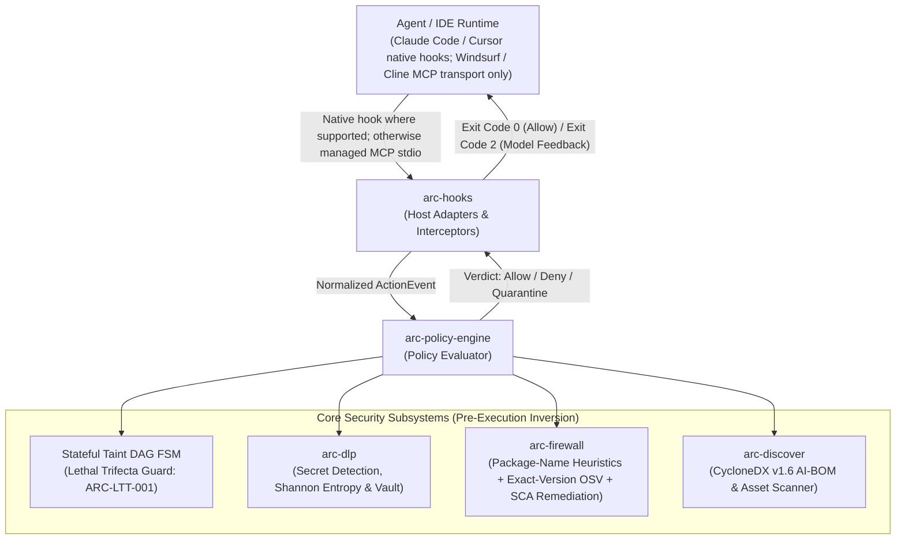

# Vexa Arc: Local Agent Security Engine & MCP Policy Broker

[](https://www.rust-lang.org/)
[](LICENSE)
[](#cross-platform-installation--setup)
[](#6-standardized-cyclonedx-v16-ai-bom-export-arc-bom)
[](#4-advisory-package-risk-checks-arc-shield)
[](#-documentation--workflow-guides)

**Vexa Arc Community** (`arc`) is an open-source, local-first developer security utility: a Rust policy engine with selected Claude Code/Cursor hook events, an explicitly invoked MCP stdio broker, and advisory package checks. It is designed for individual developers, not as a universal endpoint firewall. Actions outside configured hooks and the broker are not mediated. `arc shield` does not intercept or execute package installs.

> [!IMPORTANT]
> **Community scope:** The supported target is one developer on one workstation. Enterprise fleet enforcement is deferred. Arc is **NOT** a kernel-level EDR, **NOT** a network egress firewall, and **NOT** a replacement for commercial endpoint protection. It provides defense-in-depth only on explicitly mediated paths. Session/sink classification is heuristic, ordinary Cursor file writes bypass the scanner, and end-to-end latency has not been independently validated. See the [Community release scope and GO gates](docs/community-release-scope.md).

<p align="center">
  <a href="#quick-start-30-seconds"><b>Quick Start</b></a> •
  <a href="#core-security-pillars"><b>Core Pillars</b></a> •
  <a href="#ide--agent-hook-integrations"><b>Agent Hooks</b></a> •
  <a href="docs/user-guide.md"><b>User Guide</b></a> •
  <a href="docs/developer-guide.md"><b>Developer Guide</b></a> •
  <a href="docs/product-tiers.md"><b>Product Tiers</b></a> •
  <a href="#architecture--invariants"><b>Architecture</b></a> •
  <a href="#cli-command-reference"><b>CLI Reference</b></a>
  • <a href="docs/community-release-scope.md"><b>Community Scope / GO Gates</b></a>
</p>

---

## The Autonomous Agent Threat Model

Autonomous coding agents possess shell execution permissions, file system read/write access, and external network or MCP connectivity. Traditional endpoint protection (EDR) operates *post-execution* after processes have spawned, missing agent-specific vectors (e.g. indirect prompt injection, Lethal Trifecta, package slopsquatting).

Vexa Arc is designed for **pre-execution checks on explicitly mediated paths**; it does not intercept every process, editor write, or network request. End-to-end latency has not been validated.

```
┌────────────────────────────────────────────────────────────────────────────────────────┐
│                               AGENT RUNTIME BOUNDARY                                   │
│                                                                                        │
│   Agent Input / Host Hook  ──▶  [ Vexa Arc Engine ]  ──▶  Permitted: Execute Action     │
│   (Claude Code, Cursor, MCP)        │                     🛑 Denied: Structured JSON   │
│                                     │                         (Model Self-Correction)  │
│                                     ▼                                                  │
│   Evaluates:                                                                           │
│   1. Lethal Trifecta DAG (Private Data + Untrusted Context + Egress)                   │
│   2. Multi-Language Token Egress (curl, python urllib, node http, powershell)          │
│   3. Advisory Package-Name Heuristics + Exact-Version OSV Check                        │
│   4. Dynamic MCP Schema Rug-Pull Quarantine (RFC 8785 JCS Hash Pinning)                │
│   5. Linear-Time Code Pattern Scanning (SQL string interpolation, eval/exec, innerHTML)│
│   6. Process Lifecycle Controls (Job Objects / PR_SET_PDEATHSIG / Memory Limits)      │
└────────────────────────────────────────────────────────────────────────────────────────┘
```

---

## ⚡ Value at a Glance

| Security Dimension | Threat Vector Addressed | Vexa Arc Mechanism | CLI Command |
| :--- | :--- | :--- | :--- |
| **Observed Taint Checks** | Some mediated private-data + untrusted-context flows | Session Taint DAG and heuristic classification of selected sinks; not general egress interception | `arc intercept eval --session s1` |
| **Selected Agent Hooks** | Configured Claude Code/Cursor lifecycle events | Host hooks mediate supported events only; ordinary Cursor editor writes and unwrapped actions bypass Arc | `arc host install --host claude-code` |
| **Package Risk Check** | Package-name lookalikes and known vulnerabilities for exact versions | Advisory name heuristic; exact-version OSV check where requested; not an install control | `arc shield check lodash@4.17.21` |
| **Wrapped MCP Schema Pinning** | Schema changes on an MCP server launched through the Arc stdio broker | RFC 8785 JCS hashing; local reviewed pin or explicit development-only TOFU | `arc protect stdio --pin-schema <hash>` |
| **Process Lifecycle Controls** | Some child-process lifetime/resource risks in the wrapped broker | OS-specific lifecycle/resource controls; not sandboxing or network isolation | `arc protect stdio --max-memory-mb 512` |
| **Secret Scanning** | Supported secret patterns in explicitly scanned inputs | Pattern/entropy detector; redaction applies only where the path can apply it | `arc scan-secrets --path . --redact` |
| **Targeted Code-Pattern Scan** | Selected risky code patterns on a mediated file-write event | Aho-Corasick prefilter + targeted regex; not AST analysis or universal file-write DLP | `arc intercept eval --kind file_write` |
| **AI Asset Discovery** | Inventory of discovered AI assets/configuration | Repository/workstation scanner with CycloneDX v1.6 export; validate inventory completeness | `arc audit --output-bom ai-bom.json` |

---

## Quick Start (30 Seconds)

### 1. Build and Run from Source
```bash
# Clone and build from source with the Rust toolchain
git clone https://github.com/noviqtechnologies/vexa-arc.git
cd vexa-arc
cargo build --release

# On Linux/macOS:
./target/release/arc --help

# On Windows (PowerShell):
.\target\release\arc.exe --help
```

### 2. Immediate Diagnostic Checks
```bash
# Advisory package-name check only; this does not run or prevent npm install:
arc shield check reactt --ecosystem npm

# 🔍 Discover AI assets, MCP configs, and agent rule files across your project:
arc audit

# 🔒 Detect secrets with local pseudonymization token replacement:
arc scan-secrets --path .env --redact

# 🛡️ Install native runtime hooks for Claude Code or Cursor:
arc host install --host claude-code
arc host install --host cursor
```

*(If versioned binaries are published, use the checksums and provenance attached to that specific [GitHub Release](https://github.com/noviqtechnologies/vexa-arc/releases); do not assume unreleased artifacts are available or validated.)*

---

## Core Security Pillars

### 1. Stateful Session Taint DAG & Observed Lethal Trifecta Checks

The **Lethal Trifecta** occurs when an autonomous agent simultaneously acquires:
1. **Private Data Access** (e.g. reading `.env`, database configuration, SSH keys, internal source code)
2. **Untrusted Context Ingestion** (e.g. reading untrusted issues, web scraping, external PR comments)
3. **Outbound Egress / Execution** (e.g. posting to external webhooks, running `curl`, executing network scripts)

Arc tracks taints on events it receives in an in-memory directed acyclic graph (DAG). It can deny recognized sinks on those mediated events; it does not observe every file read, shell command, or outbound connection. The following illustrates the intended flow, not a guarantee against unrecognized sinks or bypass paths:

```bash
# 1. Agent reads sensitive local credentials -> adds PRIVATE_DATA + SECRET_MATERIAL
arc intercept eval .env --session dev-session

# 2. Agent ingests untrusted issue context -> adds UNTRUSTED_CONTENT
arc intercept prompt "https://malicious.com/issue/42" --session dev-session

# 3. If the Slack action reaches Arc and is classified as a sensitive sink, policy denies it
arc intercept eval slack/slack_post_message --session dev-session
```

#### Token-Based Multi-Language Egress Classification
Arc lexically recognizes selected command and interpreter signatures. This is heuristic detection, not a packet filter or complete language/runtime analysis. Examples the current classifier is intended to recognize include:
- **Standard utilities:** `curl`, `wget`, `nc`, `ncat`, `netcat`, `socat`, `ssh`, `scp`, `rsync`
- **Python:** `python -c "import urllib..."`, `python3 -c "import requests, socket..."`
- **Node.js:** `node -e "require('http')..."`
- **Ruby & Perl:** `ruby -e "require 'net/http'..."`, `perl -e "use LWP..."`
- **PowerShell:** `Invoke-WebRequest`, `Invoke-RestMethod`, `Start-BitsTransfer`
- **Compound commands:** Some separators/compound forms are recognized; encoded commands, aliases, arbitrary binaries, custom clients, DNS, and unrecognized syntax can evade these checks.

---

### 2. Hardened Host Onboarding & Runtime Hooks (`arc host install`)

Vexa Arc provides hardened host onboarding for **Claude Code** and **Cursor IDE**. Hook installation is designed with defensive execution preflights:
1. **Canonical Absolute Binary Path:** `arc host install` resolves `std::env::current_exe()?.canonicalize()` to ensure background hooks execute reliably even when the host IDE is launched from desktop shortcuts or GUI launchers with a minimal environment lacking shell `PATH` exports (e.g. missing `~/.cargo/bin`).
2. **Safe Path Escaping & Quoting:** Binary paths containing spaces (e.g., `C:\Users\Jane Doe\...` or `/Users/jane doe/...`), quotes, or Unicode are properly shell-quoted so subprocess tokenization never splits the executable path.
3. **Byte-for-Byte Backup:** Creates verified backups (`settings.json.arc.bak` or `hooks.json.arc.bak`) before modifying files.
4. **Safe Structural JSON Merging:** Preserves all foreign hooks and user keys; aborts cleanly without clobbering if an existing `hooks` structure is non-object (e.g. malformed string or array).

```bash
# Automatically install hardened hooks into .claude/settings.json or .cursor/hooks.json:
arc host install --host claude-code
arc host install --host cursor

# Inspect active status and detect unauthorized configuration bypasses:
arc host status --host claude-code --json
```

#### Claude Code Integration (`.claude/settings.json`)
Vexa Arc hooks into Claude Code's native `PreToolUse` and `PostToolUse` lifecycle events using the documented hook schema. Denials return exit code `2`, causing Claude Code to surface the remediation message directly to the model for automated self-correction without crashing the session:
```json
{
  "hooks": {
    "PreToolUse": [
      {
        "matcher": "*",
        "hooks": [{ "type": "command", "command": "\"/Users/dev/.cargo/bin/arc\" intercept hook --host claude-code" }]
      }
    ],
    "PostToolUse": [
      {
        "matcher": "WebFetch|WebSearch|mcp__.*",
        "hooks": [{ "type": "command", "command": "\"/Users/dev/.cargo/bin/arc\" intercept hook --host claude-code" }]
      }
    ]
  }
}
```

#### Cursor IDE Integration (`.cursor/hooks.json`)
Vexa Arc configures Cursor with `failClosed: true` across `beforeShellExecution`, `beforeMCPExecution`, `beforeReadFile`, and `afterMCPExecution`:
```json
{
  "version": 1,
  "hooks": {
    "beforeShellExecution": [{ "command": "\"C:\\Users\\dev\\.cargo\\bin\\arc.exe\" intercept hook --host cursor", "failClosed": true }],
    "beforeMCPExecution": [{ "command": "\"C:\\Users\\dev\\.cargo\\bin\\arc.exe\" intercept hook --host cursor", "failClosed": true }],
    "beforeReadFile": [{ "command": "\"C:\\Users\\dev\\.cargo\\bin\\arc.exe\" intercept hook --host cursor", "failClosed": true }],
    "afterMCPExecution": [{ "command": "\"C:\\Users\\dev\\.cargo\\bin\\arc.exe\" intercept hook --host cursor" }]
  }
}
```

---

### 3. Process Containment & Schema Pinning (`arc protect`)

When supervising stdio Model Context Protocol (MCP) servers, Vexa Arc acts as an inline security broker with OS-level containment:

```bash
# Bootstrap only after independently verifying the server artifact; capture the JCS hash on stderr:
arc protect stdio \
  --server github \
  --allow-tofu \
  -- npx @modelcontextprotocol/server-github

# Managed use: provision the reviewed hash in `.arc/signed_policy.json` under
# `mcp_schema_pins`; the CLI pin is optional and must match the signed pin:
arc protect stdio \
  --server github \
  --max-memory-mb 512 \
  -- npx @modelcontextprotocol/server-github
```

- **Process-Lifecycle Containment (not an OS sandbox):**
  - **Windows:** Creates the child suspended, assigns it to a Job Object, and resumes it; job close terminates assigned processes. Nested-job/assignment failures abort launch.
  - **Linux:** Arms `PR_SET_PDEATHSIG` for the direct child with a parent-PID race check and applies per-process `RLIMIT_AS`; process-group cleanup runs during supervisor teardown.
  - **macOS / other Unix:** Uses process-group cleanup during supervisor teardown. A hard-killed Arc parent is not guaranteed to reap detached/orphan descendants.
  - These controls do not restrict syscalls, filesystem access, or network egress; they are not a sandbox.
- **Dynamic Schema Rug-Pull Prevention (`ARC-RUG-001`):** Canonicalizes declared tool schemas using RFC 8785 JSON Canonicalization Scheme (JCS). Broker and CLI require a reviewed pin. In managed mode, the pin is taken from the verified signed organization policy; unsigned project/user policy cannot establish trust, CLI overrides must match, and a missing server pin blocks startup. `--allow-tofu` is an explicit development/bootstrap exception and is rejected when signed organization policy is active.
- **Tool Result Taint Attribution:** Outputs from external tools (e.g. GitHub issue fetches, web scraping) are ingested into the session Taint DAG before returning to the model, preventing delayed Lethal Trifecta bypasses.

---

### 4. Local Observability & Exact Session Storage Resolution (`arc session`)

Vexa Arc provides local observability over agent causal data-flow DAGs, active taint states, and operational audit trails without requiring external services or cloud logging.

#### Exact Storage Resolution Hierarchy

Session state DAGs (`<session_id>.json`) and operational audit logs (`<session_id>.audit.jsonl`) are resolved across platforms in strict priority order:

1. **CLI Flag Override:** `--session-dir <path>`
2. **Environment Variable Override:** `ARC_SESSION_DIR`
3. **Opt-in Project-Local Mode:** `--project-local` flag or `ARC_PROJECT_LOCAL=1` (resolves to `.arc/sessions` in the current working directory)
4. **Existing CWD Continuity:** If `.arc/sessions` exists in CWD and is writable, reuse it.
5. **OS User Data Directory (Standard Target):**
   - **Windows:** `%LOCALAPPDATA%\vexa-arc\sessions` (fallback: `%USERPROFILE%\.arc\vexa-arc\sessions`)
   - **macOS:** `$XDG_DATA_HOME/vexa-arc/sessions` (if set) or `~/Library/Application Support/vexa-arc/sessions`
   - **Linux:** `$XDG_DATA_HOME/vexa-arc/sessions` (if set) or `~/.local/share/vexa-arc/sessions`
6. **System Temp Directory Fallback:** `%TEMP%\vexa-arc\sessions` (Windows) or `/tmp/vexa-arc/sessions` (Linux/macOS)

```bash
# Verify resolved session directory, hierarchy source, and write permissions:
arc session storage
arc session storage --json
```

#### Causal DAG Inspection (`arc session dag`)

Inspect causal data-flow ancestry, causal depth, tainted AST argument fields, file path taints, and pinned tool schemas:

```bash
# Inspect the active causal DAG for the most recently active session:
arc session dag --latest

# Inspect a specific host session:
arc session dag default-session --json
```

#### Operational Audit Logging & Reporting (`arc session report`)

On each mediated agent action, Arc appends a structured record to `<storage_dir>/<session_id>.audit.jsonl` recording event UUID, tool/action, verdict (`Allow`, `Deny`, `RequireApproval`), rule ID, and secret redaction count:

```bash
# Generate audit summary for the latest active session:
arc session report --latest

# Aggregate audit metrics across all stored sessions:
arc session report --all --json
```

#### Pruning & Session TTL (`arc session clean`)

Prunes session files and operational audit logs older than the expiration threshold (default: 24 hours):

```bash
# Prune expired sessions older than 24 hours:
arc session clean

# Prune sessions older than a custom threshold (e.g. 1 hour):
arc session clean --max-age-hours 1 --json
```

---

### 5. Threat-Modeled Human Approval (Host Delegation & OS Modals)

Vexa Arc enforces a deterministic, threat-modeled human authorization framework for high-risk and heuristic agent actions (e.g. Lethal Trifecta triggers or unapproved MCP servers).

#### Threat Model & Security Boundaries
- **No TTY Heuristic Reliance:** Checking for a TTY does not prove a human is present; autonomous agents execute inside terminals and PTYs and can simulate user input.
- **Primary Mechanism (Host IDE Delegation):** In Claude Code and Cursor IDEs, Arc maps `Verdict::RequireApproval` to native confirmation hooks (`permissionDecision: "ask"` / `permission: "ask"`). Under the assumption that the host IDE isolates dialog input streams from agent tool execution, the agent cannot self-approve.
- **Secondary Mechanism (Out-of-Band OS Confirmation Modal):** For standalone stdio broker sessions (`arc protect stdio`):
  - **Desktop Session Preflight:** Verifies active graphical desktop (`WinSta0` with GUI display on Windows, `DISPLAY`/`WAYLAND_DISPLAY` on Linux, WindowServer on macOS).
  - **Headless Fail-Closed:** Headless environments (CI runners, Docker, SSH) without a configured webhook (`ARC_APPROVAL_WEBHOOK_URL`) **fail closed immediately** with `ARC-AUTH-HEADLESS-UNSUPPORTED`.
  - **CSPRNG 6-Digit PIN Modal:** Spawns an isolated platform GUI modal completely detached from process stdin/stderr. Prompts the human to confirm with a random 6-digit numeric PIN (~20 bits entropy).
  - **3-Attempt Rate Lockout:** Entering an incorrect PIN 3 times immediately denies the action with `ARC-AUTH-PIN-EXHAUSTED` and institutes an active **15-minute rate-lockout window** (`ARC-AUTH-LOCKED-OUT`).
  - **Rolling Rate-Limiting:** Limits approval prompts to at most 3 requests per rolling 60-second window (`ARC-AUTH-RATE-LIMITED`).
- **Canonical Action Binding & Single-Use:** Grants are bound to `SHA256(canonical_action_bytes || session_id || rule_id)` via RFC 8785 JSON Canonicalization Scheme (JCS). Grants are stored in memory and consumed atomically on first match; once consumed, they cannot be replayed.

---

### 6. Advisory Package Risk Checks (`arc shield`)

AI agents can hallucinate package names, but the current `arc shield` CLI is **not an install firewall**. It parses package names or command text and applies heuristics using seeded popular-package baselines and caller-supplied simulation values; it does not retrieve live registry age, download, lifecycle-script, provenance, or 404 data. It does not execute or intercept package-manager commands. `arc shield check name@version` can separately query OSV for known vulnerabilities in that exact version; that query is not a malicious-package verdict.

```bash
# Inspect command text only; these do not run or block the package manager:
arc shield npm install reactt
arc shield pip install shadow-agent
arc shield cargo add tokio

# Exact version vulnerability check:
arc shield check lodash@4.17.21 --ecosystem npm --json
```

1. **Ecosystem-scoped seeded popular-package baseline:** A small static baseline informs heuristic results; it is not registry attestation and cannot authorize a same-named package in another ecosystem.
2. **Name similarity and lifecycle checks:** Jaro-Winkler/Levenshtein comparisons are case-normalized; a caller-reported dangerous lifecycle signal blocks even a popular/established fast path.
3. **Caller-supplied 404/provenance fields:** These are inputs to the library engine, not signals collected by a registry proxy in this CLI. New low-history packages without SLSA provenance require review rather than an automatic permit.
4. **Exact-version OSV scan (`ARC-SCA-001`):** A concrete `name@version` may be checked against OSV with local `.sca-cache` use. No version means no exact-version scan; an unavailable uncached query can be incomplete/fail closed.

---

### 7. Consensual, Disposable-Worktree SCA Remediation (`arc sca`)

Vexa Arc provides non-contaminating Software Composition Analysis (SCA) auditing and patch remediation powered by `vexa-sca`. It scans dependencies across supported manifests (`Cargo.lock`, `package-lock.json`, `yarn.lock`, `pnpm-lock.yaml`, `requirements.txt`, `go.sum`, `pom.xml`) and provides isolated remediation without ever polluting the active developer working tree.

#### Scoped SCA Audit with SARIF (`arc sca audit`)

```bash
# Scan project dependencies for vulnerabilities:
arc sca audit

# Generate OASIS SARIF v2.1.0 with location sanitization and failure threshold:
arc sca audit --sarif audit.sarif --sanitize-locations --fail-on high
```

- **Confidentiality Invariant (`--sanitize-locations`):** Eliminates internal source code snippets, suppresses physical line/column numbers, and pseudonymizes file paths into hashed URIs (`file:///arc-scrubbed-<sha256>`).
- **Policy Failure Gating (`--fail-on <severity>`):** Returns an exit code of 1 if any vulnerability meets or exceeds the specified threshold (`critical`, `high`, `medium`, `low`).

#### Dry-Run Scratch Diff Proposal (`arc sca fix --dry-run`)

```bash
# Inspect non-destructive proposed manifest patches in isolated OS temp storage:
arc sca fix --dry-run
```

- Creates an isolated scratch copy in OS temp storage (`%TEMP%` or `/tmp`).
- Applies patches strictly within the scratch directory.
- Outputs unified diff proposals without mutating a single byte or timestamp in the working tree.

#### Isolated Disposable Git Worktree (`arc sca fix --open-pr`)

```bash
# Open an automated security PR against origin/main using an isolated worktree:
arc sca fix --open-pr --base main

# Explicitly bypass local divergence and enforce base branch:
arc sca fix --open-pr --base main --force-remote-base

# Execute project tests inside the disposable worktree before opening the PR:
arc sca fix --open-pr --base main --run-tests
```

- **Remote Base Validation & Divergence Fail-Closed:** Distinguishes Git refs (`refs/remotes/origin/<base>`) from GitHub PR base branch names (`<base>`). Evaluates local vs remote divergence and fails closed by default if unpushed commits exist, preventing unintentional commit leakage.
- **Detached Disposable Worktree:** Spawns an isolated worktree (`git worktree add --detach`) in OS temp marked with `.arc-worktree-marker.json`.
- **Single Branch Creation:** Delegates branch creation directly to `PrCreator`, avoiding Git duplicate branch conflicts.
- **RAII Lifecycle & 5-Point Safety Pruning:** Cleans up automatically via RAII `Drop`. Stale or abandoned worktrees are strictly audited against a 5-point contract (canonical temp containment, UUID format, `.git`/marker validity, user ownership, and dead PID verification) before pruning.

---

### 8. Linear-Time Secret Detection & Redaction

Provides targeted secret detection for explicitly scanned inputs and supported mediated payloads. No sub-millisecond latency or universal host/outbound coverage is claimed; actual coverage depends on the invoked command, adapter, and policy:
- **Linear-Time Aho-Corasick Prefiltering**: Eliminates latency overhead on large source files.
- **Shannon Entropy Verification**: Validates entropy thresholds on candidate substrings to prevent false alarms on test fixtures.
- **Local Pseudonymization Vault**: Can replace detected secrets with synthetic surrogate tokens (`<ARC_VAULT_SECRET_XX>`) when the applicable mediated path issues and applies a redaction obligation; this is not automatic coverage of every prompt or outbound channel.

```bash
# Scan repository or directory
arc scan-secrets --path .

# Scan standard input and redact secrets
cat app.config | arc scan-secrets --redact
# Windows PowerShell:
Get-Content app.config | arc scan-secrets --redact
```

---

### 9. Standardized CycloneDX v1.6 AI-BOM Export (`arc bom`)

Generates specification-compliant OWASP CycloneDX v1.6 AI-BOM manifests capturing AI models, datasets, declared MCP tool services, and agent instruction files (`.cursorrules`, `CLAUDE.md`, `.windsurfrules`):

```bash
# Export CycloneDX v1.6 AI-BOM to file
arc bom --path . --out cyclonedx-ai-bom.json

# Run audit and export AI-BOM simultaneously
arc audit --path . --output-bom ai-bom.json
```

---

## Architecture & Invariants



### Core Architectural Invariants

1. **Mediated Pre-Execution Checks**: Configured hooks and an explicitly invoked stdio broker evaluate selected actions before forwarding/execution; unconfigured paths bypass these controls.
2. **Latency Target (Unvalidated)**: Historical in-memory target $p_{99} < 3.5\text{ ms}$ is not measured release evidence. Benchmark full hook/broker paths and cold/warm behavior before production rollout.
3. **Local Processing With Explicit Network Exceptions**: Local parsing, code pattern checks, and taint analysis run on-host; exact-version OSV checks and the launched MCP server may use network destinations.
4. **Monotonic Taint Accumulation**: Taints (`PRIVATE_DATA`, `UNTRUSTED_CONTENT`, `SECRET_MATERIAL`, `EXTERNAL_EGRESS`) accumulate across session life cycles and cannot be reset by agent prompts.
5. **Deterministic Schema Invariance (RFC 8785)**: MCP tool schemas are canonicalized via RFC 8785 JCS and SHA-256 hashed to defeat dynamic rug-pull attacks.

---

## CLI Command Reference

All commands support relative and absolute paths, cross-platform path separators (`/` or `\`), and default to the current working directory (`.`):

| Command | Purpose | Key Flags | Example |
| :--- | :--- | :--- | :--- |
| `arc audit` | Scan project or workstation for AI assets, rules, and MCP configs | `--workstation`, `--json`, `--output-bom <PATH>` | `arc audit --output-bom ai-bom.json` |
| `arc bom` | Export CycloneDX v1.6 AI-BOM | `-p, --path <PATH>`, `-o, --out <PATH>` | `arc bom --out ai-bom.json` |
| `arc sca` | Consensual, disposable-worktree SCA scanning & PR remediation | `audit`, `fix [--dry-run | --open-pr]` | `arc sca audit --sarif audit.sarif --sanitize-locations` |
| `arc shield` | Advisory package-name heuristics; exact-version OSV check (does not intercept or run installs) | `check <PKG>`, `run <CMD>`, `--show-recommendation`, `--fail-on-risk` | `arc shield run --fail-on-risk -- npm install package` |
| `arc scan-secrets` | Scan files or stdin for secrets with entropy checks | `-p, --path <PATH>`, `--redact` | `arc scan-secrets --path . --redact` |
| `arc host` | Manage host integrations (Claude Code, Cursor) | `install`, `status`, `uninstall`, `--host <HOST>` | `arc host install --host claude-code` |
| `arc protect` | Supervise MCP servers with containment and required schema pinning | `stdio --server <NAME>`, `--pin-schema <HASH>` (or dev-only `--allow-tofu`), `--max-memory-mb <MB>` | `arc protect stdio --server fs --pin-schema "$MCP_SCHEMA_SHA256" -- npx server` |
| `arc intercept` | Intercept and evaluate agent actions against session Taint DAG | `eval`, `read`, `exec`, `mcp`, `prompt`, `hook`, `session` | `arc intercept hook --host claude-code` |
| `arc trace` | Inspect event causality and export redacted audit evidence | `<EVENT_ID>`, `latest`, `--export <PATH>`, `--json` | `arc trace latest --export trace.json` |
| `arc doctor` | Check host adapters, policy engine, and cumulative metrics | `--metrics`, `--json` | `arc doctor --metrics` |
| `arc telemetry` | Run or inspect the opt-in local pilot telemetry collector | `run`, `status --json`, `export --out <PATH>` | `arc telemetry status --json` |
| `arc version` | Display platform version and build target | N/A | `arc version` |

---

## Local Pilot Telemetry (Opt-In)

Vexa Arc can emit privacy-minimized per-action events for a local developer pilot. Telemetry is **disabled by default**, is sent only to a loopback collector, and never changes an allow/deny decision. It does not collect prompts, source code, file contents, MCP arguments, raw commands, package names, URLs, or secret values.

Start the collector in a separate terminal:

```bash
arc telemetry run
```

Enable the hook/broker client for the current process environment:

```bash
# Linux/macOS
export ARC_PILOT_TELEMETRY=local

# Windows PowerShell
$env:ARC_PILOT_TELEMETRY = "local"
```

Inspect status or export a compact local aggregate:

```bash
arc telemetry status --json
arc telemetry export --out arc-pilot-telemetry.json
```

If the collector is unavailable, Arc continues with its existing security behavior and the event is counted as telemetry loss. This feature measures mediated actions only; it is not endpoint monitoring or proof of complete agent coverage. See [Community Release Scope](docs/community-release-scope.md) and the [User Guide telemetry section](docs/user-guide.md#local-pilot-telemetry).

---

## CI/CD Quality Gate (GitHub Actions)

Integrate Vexa Arc into your CI/CD pipelines to enforce security quality gates on every push and pull request:

```yaml
name: Vexa Arc Security Gate

on: [push, pull_request]

jobs:
  arc-security-audit:
    runs-on: ubuntu-latest
    steps:
      - uses: actions/checkout@v4
      - uses: dtolnay/rust-toolchain@master
        with:
          toolchain: stable

      - name: Build Vexa Arc
        run: cargo build --release --locked

      - name: Run AI-SPM Audit & CycloneDX v1.6 AI-BOM Export
        run: ./target/release/arc audit --output-bom cyclonedx-ai-bom.json

      - name: Verify Zero Leaked Credentials
        run: ./target/release/arc scan-secrets --path .

      - name: Archive AI-BOM
        uses: actions/upload-artifact@v4
        if: always()
        with:
          name: cyclonedx-ai-bom
          path: cyclonedx-ai-bom.json
```

---

## Automated Tests & Verification

The workspace includes unit and integration test suites across its crates. Tests, formatting, and Clippy were not run during this source review because the Rust toolchain was unavailable; run these checks and review the current CI matrix before merge or deployment:

```bash
# Run the entire workspace test suite
cargo test --workspace

# Run strict clippy verification (zero warnings allowed)
cargo clippy --workspace --all-targets -- -D warnings
```

| Crate | Source/test coverage summary |
| :--- | :--- |
| **`arc-core`** | Domain models, RFC 8785 JCS canonicalization, verdict serialization |
| **`arc-dlp`** | Secret detectors, Shannon entropy, pseudonymization vault, targeted code-pattern checks (not a parser/AST analyzer; `ARC-AST-001`) |
| **`arc-policy-engine`** | Stateful Taint DAG, Lethal Trifecta (`ARC-LTT-001`), server/content untrusted taint, heuristic shell-egress classification |
| **`arc-discover`** | Workstation/repository asset discovery, agent instruction files, CycloneDX v1.6 AI-BOM export |
| **`arc-firewall`** | Advisory package-name heuristics, exact-coordinate OSV scanner (`ARC-SCA-001`), command parsing; no install interception |
| **`arc-hooks`** | Claude Code and Cursor adapters, process-lifecycle controls (not sandboxing), required-by-default MCP schema pins |
| **`arc-cli`** | CLI dispatch and integration flows; current test results require CI validation |

---

## 📖 Documentation & Workflow Guides

For complete architecture diagrams, implementation walk-throughs, and configuration schemas:

- 📘 [**User Guide**](docs/user-guide.md): Complete setup, CLI workflows, IDE integration (Claude Code, Cursor, Windsurf), Lethal Trifecta mitigation, and FAQ.
- 🛠️ [**Developer Guide**](docs/developer-guide.md): Technical architecture, crate topology, normalized `ActionEvent` contracts, RFC 8785 JCS, and extending test suites.
- [**Product Tier Matrix**](docs/product-tiers.md): Community features for the upcoming release and explicitly planned Team/Enterprise options; roadmap, not an availability promise.
- [**Community Release Scope**](docs/community-release-scope.md): Supported local use, limitations, and stable-release gates.

---

## License

Licensed under the [Apache License, Version 2.0](LICENSE).
