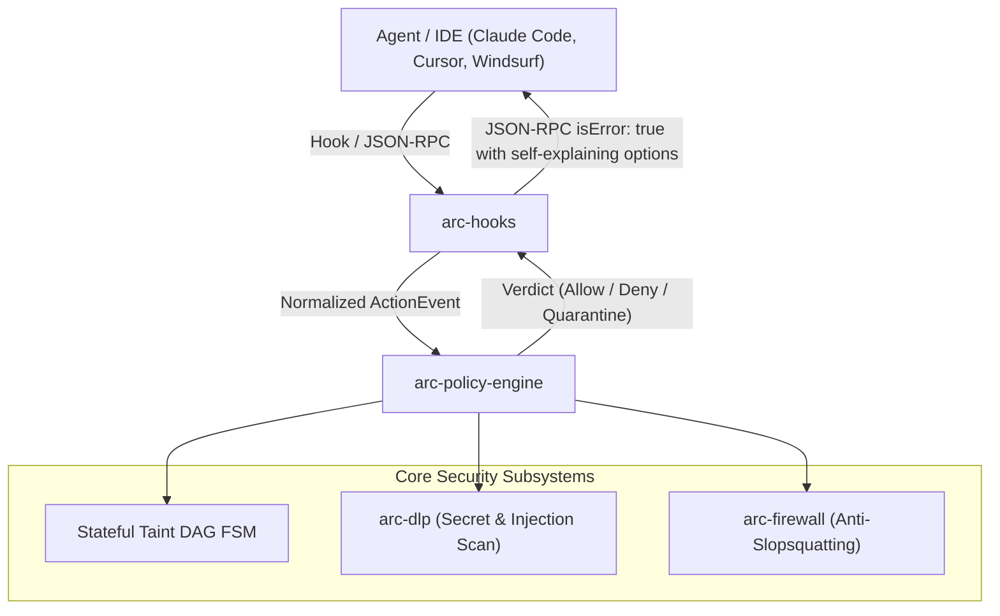
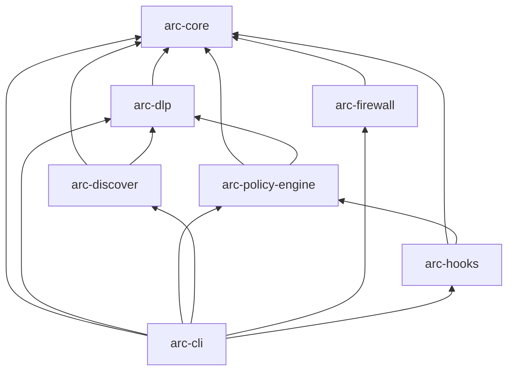

# Vexa Arc Developer Guide

Welcome to the **Vexa Arc (Agentic Runtime Control)** Developer Guide. This document provides technical architecture details, domain contracts, development workflows, and extension guidelines for engineers contributing to Vexa Arc.

---

## Table of Contents

1. [Architecture Principles & System Blueprint](#1-architecture-principles--system-blueprint)
2. [Workspace & Crate Hierarchy](#2-workspace--crate-hierarchy)
3. [Core Rust Contracts](#3-core-rust-contracts)
   - [Normalized Action Event (`arc-core::event`)](#normalized-action-event-arc-coreevent)
   - [Decision Verdicts & Explanations (`arc-core::verdict`)](#decision-verdicts--explanations-arc-coreverdict)
   - [Monotonic Taint Labels & Sinks (`arc-core::taint`)](#monotonic-taint-labels--sinks-arc-coretaint)
   - [3D MCP Risk Profiling & JCS Hashing (`arc-core::mcp_profile`)](#3d-mcp-risk-profiling--jcs-hashing-arc-coremcp_profile)
4. [DLP & Context Sanitization Engine (`arc-dlp`)](#4-dlp--context-sanitization-engine-arc-dlp)
   - [Multi-Stage Secret Detector](#multi-stage-secret-detector)
   - [Inbound Prompt Injection Sanitization & Nonce Delimitation](#inbound-prompt-injection-sanitization--nonce-delimitation)
   - [Local Pseudonymization Vault](#local-pseudonymization-vault)
5. [Stateful Session Taint DAG & Policy Engine (`arc-policy-engine`)](#5-stateful-session-taint-dag--policy-engine-arc-policy-engine)
6. [Asset Discovery & CycloneDX v1.6 AI-BOM (`arc-discover`)](#6-asset-discovery--cyclonedx-v16-ai-bom-arc-discover)
7. [Dependency Firewall & Compound Anti-Slopsquatting (`arc-firewall`)](#7-dependency-firewall--compound-anti-slopsquatting-arc-firewall)
8. [Host Adapters & MCP JSON-RPC Interceptors (`arc-hooks`)](#8-host-adapters--mcp-json-rpc-interceptors-arc-hooks)
9. [CLI Binary (`arc-cli`)](#9-cli-binary-arc-cli)
10. [Development, Testing & Extension Points](#10-development-testing--extension-points)
    - [Adding a New Secret Detector](#adding-a-new-secret-detector)
    - [Adding a New Package Ecosystem](#adding-a-new-package-ecosystem)
    - [Adding a New Host Adapter](#adding-a-new-host-adapter)
    - [Running Tests & Benchmarks](#running-tests--benchmarks)

---

## 1. Architecture Principles & System Blueprint

Vexa Arc operates under three core engineering invariants:
1. **The Pre-Execution Inversion:** Security enforcement must occur *pre-execution* on the developer endpoint and in CI, before malicious shell scripts or indirect prompt injections reach disk or execute.
2. **Sub-Millisecond Latency Budget:** All in-memory evaluations, regex prefiltering, and taint checking must meet $p_{99} < 3.5\text{ ms}$ budgets to guarantee zero perceived developer friction.
3. **Zero Network Egress Invariant:** All discovery, parsing, DLP pattern matching, and taint tracking occur entirely in-process without network transmissions.



---

## 2. Workspace & Crate Hierarchy

Vexa Arc follows strict downward dependency layering:



* **`#![forbid(unsafe_code)]`** is enforced across domain logic crates.
* Libraries use **`thiserror`**; the CLI binary handles user-facing errors cleanly.

---

## 3. Core Rust Contracts

### Normalized Action Event (`arc-core::event`)

All host-specific payloads are normalized into a unified `ActionEvent`:

```rust
pub struct ActionEvent {
    pub event_id: Uuid,                // UUIDv7, time-ordered
    pub observed_at_unix_ms: u64,
    pub host: AgentHost,               // ClaudeCode, Cursor, Windsurf, etc.
    pub host_session_id: String,
    pub os_principal: OsPrincipal,     // Uid(u32) or Sid(String)
    pub phase: Phase,                  // Pre or Post
    pub action: Action,
}
```

Supported `Action` variants:
- `McpToolCall { server: ServerIdentity, tool: String, arguments: Value }`
- `McpToolResult { server: ServerIdentity, tool: String, content: String, is_error: bool }`
- `McpToolsList { server: ServerIdentity, tools_json: String }`
- `Shell { command: String, cwd: PathBuf }`
- `FileRead { path: PathBuf }`
- `FileWrite { path: PathBuf, new_content: Option<String> }`
- `PackageInstall { ecosystem: Ecosystem, name: String, version: Option<String> }`
- `PromptSubmit { text: String }`

### Decision Verdicts & Explanations (`arc-core::verdict`)

When an action is evaluated, Arc returns a `Verdict`:

```rust
pub enum Verdict {
    Allow { obligations: Vec<Obligation> },
    Deny { rule: RuleId, explanation: Explanation },
    RequireApproval { rule: RuleId, explanation: Explanation, timeout_secs: u32, on_timeout: TimeoutAction },
    Quarantine { rule: RuleId, explanation: Explanation },
}
```

An `Explanation` includes a one-sentence summary, 1 to 3 self-service options, and an optional policy URL:

```rust
pub struct Explanation {
    pub summary: String,
    pub options: Vec<String>,
    pub policy_url: Option<String>,
}
```

### Monotonic Taint Labels & Sinks (`arc-core::taint`)

In accordance with ADR-004, session taints are **strictly monotonic** and never cleared during an active session:

```rust
bitflags::bitflags! {
    pub struct Taint: u16 {
        const PRIVATE_DATA      = 1 << 0;
        const UNTRUSTED_CONTENT = 1 << 1;
        const SECRET_MATERIAL   = 1 << 2;
        const PRIVILEGED_DATA   = 1 << 3;
    }

    pub struct SinkClass: u16 {
        const EXTERNAL_EGRESS = 1 << 0;
        const PUBLISH         = 1 << 1;
        const DESTRUCTIVE     = 1 << 2;
        const CODE_EXECUTION  = 1 << 3;
    }
}
```

### 3D MCP Risk Profiling & JCS Hashing (`arc-core::mcp_profile`)

Quantifies the "Lethal Trifecta" dimensions ($0\text{--}1000$):
* `private_data_exposure`: local filesystem, database, or credentials access.
* `untrusted_content_ingest`: web crawl, issue/PR comment ingestion.
* `destructive_capabilities`: outbound network, file deletion, shell execution.
* `canonical_schema_hash`: RFC 8785 JSON Canonicalization Scheme (JCS) SHA-256 hash calculated over tool definitions to detect rug-pulls across restarts.

---

## 4. DLP & Context Sanitization Engine (`arc-dlp`)

### Multi-Stage Secret Detector

The detection engine combines:
1. **Aho-Corasick Multi-Pattern Prefilter:** Quickly identifies candidate keywords in linear time ($< 0.1\text{ ms}$):
   - AWS Access Key IDs (`AKIA`) and Session Keys (`ASIA`)
   - GitHub Personal Access Tokens (`ghp_`, `github_pat_`)
   - Anthropic API Keys (`sk-ant-api`) and OpenAI Keys (`sk-proj-`)
   - Slack Bot Tokens (`xoxb-`)
   - Cryptographic Private Keys (`-----BEGIN RSA/EC/OPENSSH/DSA PRIVATE KEY-----`)
   - JSON Web Tokens (`eyJ`)
   - Stripe Live Secret and Restricted Keys (`sk_live_`, `rk_live_`)
   - Google Cloud API Keys (`AIza`)
   - PyPI API Tokens (`pypi-`) and npm Access Tokens (`npm_`)
   - Database Connection Strings (`postgres://`, `postgresql://`, `mysql://`, `mongodb://`, `redis://`)
2. **Linear-Time Anchored Regex:** Confirms structural token boundaries and format validation.
3. **Shannon & Normalized Entropy:** Ensures false-positive resistance ($H(X) \ge 4.2$, normalized entropy $H_{\text{norm}} \ge 0.85$).

### Inbound Prompt Injection Sanitization & Nonce Delimitation

* **Unicode Stripping:** Eliminates invisible Unicode tags (`U+E0000`..`U+E007F`), zero-width joiners/spaces (`U+200B`, `U+200C`, `U+200D`, `U+2060`, `U+FEFF`), Trojan Source bidi overrides (`U+202A`..`U+202E`, `U+2066`..`U+2069`), and variation selectors (`U+FE00`..`U+FE0F`, `U+E0100`..`U+E01EF`).
* **Cryptographic Spotlighting:** Encloses external content inside random 128-bit hex nonce boundaries (`<<<ARC_UNTRUSTED_CONTENT_<nonce> source="<source>">>>`), escaping nested occurrences.

### Local Pseudonymization Vault

Provides the `LocalPseudonymizationVault`:
* `redact_and_vault(session_id, raw_bytes, findings) -> (redacted_bytes, tokens)`
* Stores mappings in volatile memory (`<ARC_VAULT_SECRET_XX> -> raw_bytes`).
* `rehydrate(session_id, token, target_tool) -> Option<raw_bytes>` allows rehydration exclusively for explicitly authorized tools.

---

### AST Pattern Injection Hook (`ARC-AST-001`) — FR-CORE-006

`AstPatternEngine` in [`crates/arc-dlp/src/ast_pattern.rs`](file:///c:/vexa-arc/crates/arc-dlp/src/ast_pattern.rs) runs as a first-class step in `PolicyEvaluator::evaluate` for `Action::FileWrite`:

```rust
// Integration in arc-policy-engine/src/evaluator.rs
if let Action::FileWrite { path, content } = &event.action {
    if let Some(hit) = engine.check(content) {
        return Verdict::Block { rule: "ARC-AST-001", explanation: hit };
    }
}
```

**Performance:** Uses Aho-Corasick multi-pattern prefilter across the whole buffer, then applies regex only at confirmed hit sites. Benchmarked at **< 0.1ms** for 256 KiB on debug builds; well within the 8ms NFR budget.

---

## 5. Stateful Session Taint DAG & Policy Engine (`arc-policy-engine`)

The policy engine tracks chronological agent interactions as a **Directed Acyclic Graph (DAG)** maintained in `SessionTaintDag` instances indexed by `session_id`.

### Policy Configuration & Custom Allow-Lists (`PolicyConfig`)

Projects can customize runtime governance by placing `.arc/policy.json` or `.arc.json` in their repository root:
```json
{
  "allowed_mcp_servers": ["github", "local-filesystem", "git", "sqlite"],
  "block_unapproved_mcp": false,
  "enforce_taint_dag": true,
  "redact_secrets": true
}
```
`PolicyConfig::load_from_dir(&Path)` automatically resolves project-level configurations, falling back to defaults if omitted.

### Why a Directed Acyclic Graph (DAG)?

* **Causality & Flow Modeling:** An agent's workflow consists of sequential context-building steps (e.g. `FileRead(.env)` $\to$ `IngestPrompt(web_url)` $\to$ `McpCall(slack)`). Modeling this as a directed graph ensures that policy enforcement preserves causal ancestry—Arc knows *which* prior events contributed to the current action request.
* **Strict Acyclicity:** Session time and state progression move monotonically forward. Because actions cannot alter past history, the graph is acyclic by design, preventing infinite traversal loops and guaranteeing deterministic, linear-time evaluation ($O(1)$ bitmask checks).
* **Monotonic Accumulation:** Taint labels are accumulated additively into a bitmask (`u16`). Once `PRIVATE_DATA` or `UNTRUSTED_CONTENT` is introduced into a session, the taint persists until the session is explicitly reset (`arc intercept session <id> --reset`).
* **Cross-OS Path Normalization:** Paths in `Action::FileRead` are normalized across backslashes (`\`) and forward slashes (`/`), ensuring secrets (`.env`, `.ssh/id_ed25519`, `.aws`) trigger `PRIVATE_DATA | SECRET_MATERIAL` identically across Windows, macOS, and Linux.

**Lethal Trifecta Condition:**
$$\text{SessionTaints} \supseteq (\text{PRIVATE\_DATA} \cup \text{UNTRUSTED\_CONTENT}) \quad \land \quad \text{SinkClass} \supseteq \text{EXTERNAL\_EGRESS}$$

When this invariant is triggered, `evaluator.evaluate()` immediately emits `RuleId("ARC-LTT-001")`.

### Field-Level & Path-Level Taint Isolation — FR-TAINT-005

`SessionTaintDag` stores taint at two granularities beyond the session bitmask:

```rust
pub struct SessionTaintDag {
    pub session_taints: Taint,
    pub field_taints: HashMap<String, Taint>,  // e.g. "env.DATABASE_URL"
    pub path_taints: HashMap<String, Taint>,   // e.g. ".env", ".ssh/id_rsa"
    // ...
}
```

- `check_field_level_lethal_trifecta(field, sink)` — tests the trifecta only for a specific field.
- `check_event_trifecta_with_target(target, sink)` — tests using path-level granularity.
- **Benign isolation:** Local commands (`git status`, `git diff`, `git log`, `cargo test`, `npm test`) bypass the session bitmask check entirely via `is_benign_local_command()`.
- `compute_integrity_hash()` deterministically incorporates sorted field and path taints, preventing hash manipulation.

---


## 6. Asset Discovery & CycloneDX v1.6 AI-BOM (`arc-discover`)

- `DiscoveryScanner::audit_directory(&Path) -> AuditReport`: Walks directory structures, parses `.cursor/mcp.json`, `.claude.json`, Claude Desktop configs, Windsurf configs, agent skills (`CLAUDE.md`, `.cursorrules`, `.windsurfrules`, `.cursor/rules/*.mdc`, `.prompt.md`), and model checkpoints (`.gguf`, `.safetensors`, `.onnx`, `.pt`, `.bin`).
- `generate_cyclonedx_1_6_bom(&AuditReport) -> CycloneDxBom`: Serializes to official CycloneDX v1.6 specification with `machine-learning-model` components, `data` components for skills, and `services` for MCP servers.

---

## 7. Dependency Firewall & Compound Anti-Slopsquatting (`arc-firewall`)

The 4-gate compound scoring engine (`CompoundAntiSlopsquatEngine`):
1. **Dangerous Lifecycle Gate:** Blocks newly registered packages attempting execution in `preinstall`/`postinstall`/`setup.py`.
2. **Phantom Watchlist Gate:** Blocks packages on hallucination / recent 404 watchlists.
3. **Typosquat Gate:** Blocks packages with Levenshtein $\le 2$ or Jaro-Winkler $\ge 0.92$ against top popular packages.
4. **Provenance Gate:** Blocks packages lacking active repository history ($0$ stars, $0$ commits).

Package command interceptors (`PackageFirewall::parse_command`) support:
- `npm install`, `npm i`, `npm add`
- `pnpm add`, `pnpm install`
- `yarn add`
- `pip install`, `uv add`, `uv pip install`
- `python -m pip install`, `python3 -m pip install`
- `cargo add`
- `go get`

### OSV/EPSS Integration (`OsvPackageScanner`) — FR-PKG-005 & FR-PKG-006

[`crates/arc-firewall/src/osv_scanner.rs`](file:///c:/vexa-arc/crates/arc-firewall/src/osv_scanner.rs) provides `OsvPackageScanner`:

```rust
let scanner = OsvPackageScanner::default(); // uses .sca-cache by default
let result = scanner.scan_package("lodash", "4.17.15", "npm")?;

if result.should_block() {
    // FR-PKG-006: structured JSON-RPC error
    let error_json = result.aggregate_jsonrpc_error();
    // {"error": "Vulnerable package lodash@4.17.15; update constraint to >=4.17.21",
    //  "rule_id": "ARC-SCA-001", "severity": "HIGH", ...}
}
```

Key design decisions:
- **100% payload locality:** Only `(name, version, ecosystem)` tuples are sent to `api.osv.dev`. No source code, prompts, or credentials leave the host.
- **Air-gapped cache:** `VulnCache` stores advisories as JSON in `.sca-cache/` with 24-hour TTL. When `advisory_status.is_service_unavailable()`, the scanner returns `advisory_available: false` and does not block (fail-open for availability; slopsquat gate still runs fail-closed).
- **Sync wrapper:** `scan_package()` spawns a `tokio::runtime::Builder::new_current_thread()` runtime internally, keeping `PackageFirewall`'s public API synchronous.
- **Ecosystem bridge:** `ecosystem_to_osv_str(arc_core::event::Ecosystem)` converts between the arc-core `Ecosystem` enum and OSV string identifiers (`npm`, `PyPI`, `crates.io`, `Go`).

---

## 8. Host Adapters & MCP JSON-RPC Interceptors (`arc-hooks`)

Vexa Arc defines a standard, extensible `HostAdapter` trait in [`crates/arc-hooks/src/adapter.rs`](file:///c:/vexa-arc/crates/arc-hooks/src/adapter.rs) for IDE and agent lifecycle management:

```rust
pub trait HostAdapter {
    fn host(&self) -> AgentHost;
    fn install(&self, target_dir: &Path) -> Result<PathBuf, ArcError>;
    fn uninstall(&self, target_dir: &Path) -> Result<(), ArcError>;
    fn status(&self, target_dir: &Path) -> HostIntegrationStatus;
    fn detect_bypass(&self, target_dir: &Path) -> Result<bool, ArcError>;
}
```

- **`ClaudeCodeAdapter`**: Manages `.claude.json` / `~/.claude.json` `preToolUse` hook integrations. Automatically injects `arc intercept eval` hooks, detects hook tampering/bypasses, and safely restores configurations upon uninstall.
- **`CursorAdapter`**: Manages `.cursor/settings.json` `cursor.agent.preHookCommand` integrations for shell and MCP action supervision.
- **`McpJsonRpcInterceptor`**: Decodes standard MCP JSON-RPC requests, extracts RFC 8785 canonical schema fingerprints, and produces compliant `isError: true` JSON-RPC error responses with remediation options.
- **`McpStdioBroker`**: A managed stdio supervisor proxying child process stdin/stdout, enforcing pre-execution allow-list rules, outbound DLP secret redaction, and runtime schema drift quarantine.

### OS-Level Process Containment (`OsProcessSupervisor`) — FR-HOOKS-003

[`crates/arc-hooks/src/process_containment.rs`](file:///c:/vexa-arc/crates/arc-hooks/src/process_containment.rs) provides `OsProcessSupervisor` which is called from `McpStdioBroker::run_stdio` before spawning MCP child processes:

```rust
// Wrap child command with OS containment before spawning
OsProcessSupervisor::apply_containment(&mut cmd);
let child = cmd.spawn()?;
```

**Platform implementations (conditional compilation):**

| Target | Implementation | Guarantee |
| :--- | :--- | :--- |
| `cfg(windows)` | `CreateJobObject` + `AssignProcessToJobObject` + `JOBOBJECT_BASIC_LIMIT_INFORMATION` with `JOB_OBJECT_LIMIT_KILL_ON_JOB_CLOSE` | Child killed when Job handle drops |
| `cfg(target_os = "linux")` | `cmd.process_group(0)` + `pre_exec(prctl(PR_SET_PDEATHSIG, SIGKILL))` | SIGKILL sent on broker parent death |
| `cfg(unix)` (macOS, BSD) | `cmd.process_group(0)` — `killpg(pgid, SIGKILL)` on Drop | Entire process group reaped |

---


## 9. CLI Binary (`arc-cli`)

The root binary tying the subsystems together with `clap`.

### Command Invocations Across Operating Systems

| Command | Windows (PowerShell) | Linux / macOS (Bash/Zsh) |
| :--- | :--- | :--- |
| **Audit Repository** | `PS C:\vexa-arc\target\release> .\arc.exe audit` | `arc audit` |
| **Audit Workstation** | `PS C:\vexa-arc\target\release> .\arc.exe audit --workstation` | `arc audit --workstation` |
| **Export CycloneDX BOM** | `PS C:\vexa-arc\target\release> .\arc.exe bom --path . --out bom.json` | `arc bom --path . --out bom.json` |
| **Scan Directory Secrets** | `PS C:\vexa-arc\target\release> .\arc.exe scan-secrets --path .\src` | `arc scan-secrets --path ./src` |
| **Scan Piped Stdin** | `Get-Content log.txt \| .\arc.exe scan-secrets --redact` | `cat log.txt \| arc scan-secrets --redact` |
| **Shield Firewall Check** | `PS C:\vexa-arc\target\release> .\arc.exe shield check reactt` | `arc shield check reactt` |
| **Shield Containment Run** | `PS C:\vexa-arc\target\release> .\arc.exe shield run --enforce npm i express` | `arc shield run --enforce npm i express` |
| **Host Integration** | `PS C:\vexa-arc\target\release> .\arc.exe host install --host claude-code` | `arc host install --host claude-code` |
| **Diagnostics & Metrics** | `PS C:\vexa-arc\target\release> .\arc.exe doctor --metrics` | `arc doctor --metrics` |
| **Trace & Export Evidence** | `PS C:\vexa-arc\target\release> .\arc.exe trace latest --export trace.json` | `arc trace latest --export trace.json` |
| **Session Pruning** | `PS C:\vexa-arc\target\release> .\arc.exe intercept session --cleanup` | `arc intercept session --cleanup` |

---

## 10. Development, Testing & Extension Points

### Adding a New Secret Detector

1. Add target pattern keywords to `SecretScanEngine::new()` in [`crates/arc-dlp/src/detector.rs`](file:///c:/vexa-arc/crates/arc-dlp/src/detector.rs).
2. Define the linear-time regular expression and minimum entropy threshold.
3. Add a unit test covering positive, negative, Unicode, and boundary cases.

### Adding a New Package Ecosystem

1. Add the ecosystem variant to `Ecosystem` in [`crates/arc-core/src/event.rs`](file:///c:/vexa-arc/crates/arc-core/src/event.rs).
2. Extend CLI command parsing in `PackageFirewall::parse_command()` in [`crates/arc-firewall/src/proxy.rs`](file:///c:/vexa-arc/crates/arc-firewall/src/proxy.rs).
3. Implement containment shimming (`--ignore-scripts` injection) in `PackageFirewall::enforce_containment()`.

### Adding a New Host Adapter

1. Implement the `HostAdapter` trait in [`crates/arc-hooks/src/adapter.rs`](file:///c:/vexa-arc/crates/arc-hooks/src/adapter.rs).
2. Expose the adapter in `arc-hooks::lib.rs` and connect it to `run_host_install`, `run_host_status`, and `run_host_uninstall` in [`crates/arc-cli/src/main.rs`](file:///c:/vexa-arc/crates/arc-cli/src/main.rs).
3. Add diagnostic telemetry checks in `run_doctor`.

### Running Tests & Verification Suite

Vexa Arc maintains an automated test suite across all 7 workspace crates:

```bash
# Run all workspace unit and integration tests (82 tests):
cargo test --workspace

# Run integration tests specifically:
cargo test --test integration_tests

# Run latency benchmark suite:
cargo test --test integration_tests test_complete_path_latency_benchmark -- --nocapture

# Validate code formatting and zero-warning linting:
cargo fmt --check
cargo clippy --workspace -- -D warnings
```

### Building & Running Tests Across Operating Systems

#### Windows (PowerShell)
```powershell
# Build workspace in release mode
PS C:\vexa-arc> cargo build --release
PS C:\vexa-arc\target\release> .\arc.exe --version

# Run all unit tests across the 7 crates
PS C:\vexa-arc> cargo test --workspace

# Run integration tests specifically
PS C:\vexa-arc> cargo test --test integration_tests
```

#### Linux & macOS (Bash / Zsh)
```bash
# Build workspace in release mode
cargo build --release
./target/release/arc --version

# Run all unit tests across the 7 crates
cargo test --workspace

# Run integration tests specifically
cargo test --test integration_tests
```
