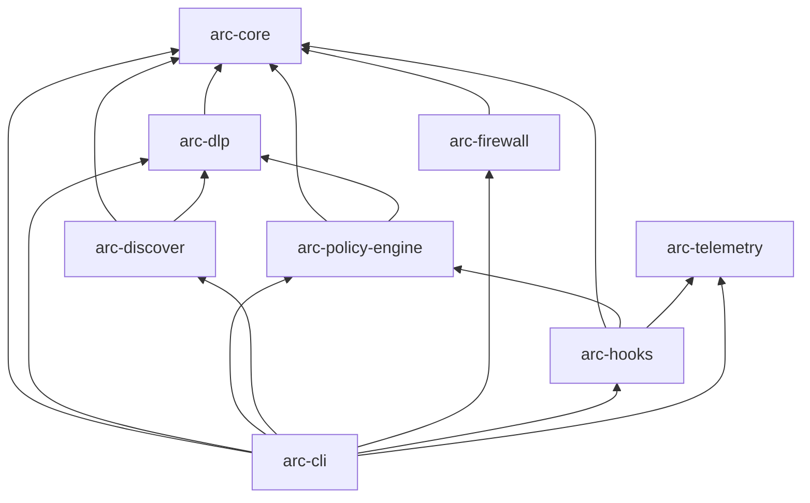

# Vexa Arc Developer Guide

Welcome to the **Vexa Arc (Agentic Runtime Control)** Developer Guide. This document provides technical architecture details, domain contracts, development workflows, and extension guidelines for engineers contributing to Vexa Arc.

---

## Table of Contents

1. [Architecture Principles & System Blueprint](#1-architecture-principles--system-blueprint)
2. [Workspace & Crate Hierarchy](#2-workspace--crate-hierarchy)
3. [Core Rust Contracts](#3-core-rust-contracts)
   - [Normalized Action Event (`arc-core::event`)](#normalized-action-event-arc-coreevent)
   - [Decision Verdicts & Explanations (`arc-core::verdict`)](#decision-verdicts--explanations-arc-coreverdict)
   - [Monotonic Taint Labels & Sinks (`arc-core::taint`)](#monotonic-taint-labels--sinks-arc-coretaint)
   - [3D MCP Risk Profiling & JCS Hashing (`arc-core::mcp_profile`)](#3d-mcp-risk-profiling--jcs-hashing-arc-coremcp_profile)
4. [DLP & Context Sanitization Engine (`arc-dlp`)](#4-dlp--context-sanitization-engine-arc-dlp)
   - [Multi-Stage Secret Detector](#multi-stage-secret-detector)
   - [Inbound Prompt Injection Sanitization & Nonce Delimitation](#inbound-prompt-injection-sanitization--nonce-delimitation)
   - [Local Pseudonymization Vault](#local-pseudonymization-vault)
5. [Stateful Session Taint DAG & Policy Engine (`arc-policy-engine`)](#5-stateful-session-taint-dag--policy-engine-arc-policy-engine)
6. [Asset Discovery & CycloneDX v1.6 AI-BOM (`arc-discover`)](#6-asset-discovery--cyclonedx-v16-ai-bom-arc-discover)
7. [Dependency Firewall & Compound Anti-Slopsquatting (`arc-firewall`)](#7-dependency-firewall--compound-anti-slopsquatting-arc-firewall)
8. [Host Adapters & MCP JSON-RPC Interceptors (`arc-hooks`)](#8-host-adapters--mcp-json-rpc-interceptors-arc-hooks)
9. [CLI Binary (`arc-cli`)](#9-cli-binary-arc-cli)
10. [Development, Testing & Extension Points](#10-development-testing--extension-points)
11. [Community, Team & Enterprise Roadmap](#11-community-team--enterprise-roadmap)
    - [Adding a New Secret Detector](#adding-a-new-secret-detector)
    - [Adding a New Package Ecosystem](#adding-a-new-package-ecosystem)
    - [Adding a New Host Adapter](#adding-a-new-host-adapter)
    - [Running Tests & Benchmarks](#running-tests--benchmarks)

---

## 1. Architecture Principles & System Blueprint

The following are engineering goals, not universal or independently validated guarantees:
1. **Pre-Execution on Mediated Paths:** Configured host hooks and `arc protect stdio` evaluate selected actions before forwarding/execution; direct or unsupported paths are not intercepted.
2. **Latency Target:** A historical in-memory target is $p_{99} < 3.5\text{ ms}$, but full hook/broker latency and developer workflow impact still require reproducible measurements.
3. **Local Processing With Network Exceptions:** Local discovery, parsing, DLP matching, and taint tracking execute on-host. Exact-version OSV queries and explicitly launched MCP servers may use network access.


---

## 2. Workspace & Crate Hierarchy

Vexa Arc follows strict downward dependency layering:



* **`#![forbid(unsafe_code)]`** is enforced across domain logic crates.
* Libraries use **`thiserror`**; the CLI binary handles user-facing errors cleanly.

---

## 3. Core Rust Contracts

### Normalized Action Event (`arc-core::event`)

All host-specific payloads are normalized into a unified `ActionEvent`:

```rust
pub struct ActionEvent {
    pub event_id: Uuid,                // UUIDv7, time-ordered
    pub observed_at_unix_ms: u64,
    pub host: AgentHost,               // ClaudeCode, Cursor, Windsurf, etc.
    pub host_session_id: String,
    pub os_principal: OsPrincipal,     // Uid(u32) or Sid(String)
    pub phase: Phase,                  // Pre or Post
    pub action: Action,
}
```

Supported `Action` variants:
- `McpToolCall { server: ServerIdentity, tool: String, arguments: Value }`
- `McpToolResult { server: ServerIdentity, tool: String, content: String, is_error: bool }`
- `McpToolsList { server: ServerIdentity, tools_json: String }`
- `Shell { command: String, cwd: PathBuf }`
- `FileRead { path: PathBuf }`
- `FileWrite { path: PathBuf, new_content: Option<String> }`
- `PackageInstall { ecosystem: Ecosystem, name: String, version: Option<String> }`
- `PromptSubmit { text: String }`

### Decision Verdicts & Explanations (`arc-core::verdict`)

When an action is evaluated, Arc returns a `Verdict`:

```rust
pub enum Verdict {
    Allow { obligations: Vec<Obligation> },
    Deny { rule: RuleId, explanation: Explanation },
    RequireApproval { rule: RuleId, explanation: Explanation, timeout_secs: u32, on_timeout: TimeoutAction },
    Quarantine { rule: RuleId, explanation: Explanation },
}
```

An `Explanation` includes a one-sentence summary, 1 to 3 self-service options, and an optional policy URL:

```rust
pub struct Explanation {
    pub summary: String,
    pub options: Vec<String>,
    pub policy_url: Option<String>,
}
```

### Monotonic Taint Labels & Sinks (`arc-core::taint`)

In accordance with ADR-004, session taints are **strictly monotonic** and never cleared during an active session:

```rust
bitflags::bitflags! {
    pub struct Taint: u16 {
        const PRIVATE_DATA      = 1 << 0;
        const UNTRUSTED_CONTENT = 1 << 1;
        const SECRET_MATERIAL   = 1 << 2;
        const PRIVILEGED_DATA   = 1 << 3;
    }

    pub struct SinkClass: u16 {
        const EXTERNAL_EGRESS = 1 << 0;
        const PUBLISH         = 1 << 1;
        const DESTRUCTIVE     = 1 << 2;
        const CODE_EXECUTION  = 1 << 3;
    }
}
```

### 3D MCP Risk Profiling & JCS Hashing (`arc-core::mcp_profile`)

Quantifies the "Lethal Trifecta" dimensions ($0\text{--}1000$):
* `private_data_exposure`: local filesystem, database, or credentials access.
* `untrusted_content_ingest`: web crawl, issue/PR comment ingestion.
* `destructive_capabilities`: outbound network, file deletion, shell execution.
* `canonical_schema_hash`: RFC 8785 JSON Canonicalization Scheme (JCS) SHA-256 hash calculated over tool definitions to detect rug-pulls across restarts.

---

## 4. DLP & Context Sanitization Engine (`arc-dlp`)

### Multi-Stage Secret Detector

The detection engine combines:
1. **Aho-Corasick Multi-Pattern Prefilter:** Quickly identifies candidate keywords in linear time ($< 0.1\text{ ms}$):
   - AWS Access Key IDs (`AKIA`) and Session Keys (`ASIA`)
   - GitHub Personal Access Tokens (`ghp_`, `github_pat_`)
   - Anthropic API Keys (`sk-ant-api`) and OpenAI Keys (`sk-proj-`)
   - Slack Bot Tokens (`xoxb-`)
   - Cryptographic Private Keys (`-----BEGIN RSA/EC/OPENSSH/DSA PRIVATE KEY-----`)
   - JSON Web Tokens (`eyJ`)
   - Stripe Live Secret and Restricted Keys (`sk_live_`, `rk_live_`)
   - Google Cloud API Keys (`AIza`)
   - PyPI API Tokens (`pypi-`) and npm Access Tokens (`npm_`)
   - Database Connection Strings (`postgres://`, `postgresql://`, `mysql://`, `mongodb://`, `redis://`)
2. **Linear-Time Anchored Regex:** Confirms structural token boundaries and format validation.
3. **Shannon & Normalized Entropy:** Ensures false-positive resistance ($H(X) \ge 4.2$, normalized entropy $H_{\text{norm}} \ge 0.85$).

### Inbound Prompt Injection Sanitization & Nonce Delimitation

* **Unicode Stripping:** Eliminates invisible Unicode tags (`U+E0000`..`U+E007F`), zero-width joiners/spaces (`U+200B`, `U+200C`, `U+200D`, `U+2060`, `U+FEFF`), Trojan Source bidi overrides (`U+202A`..`U+202E`, `U+2066`..`U+2069`), and variation selectors (`U+FE00`..`U+FE0F`, `U+E0100`..`U+E01EF`).
* **Cryptographic Spotlighting:** Encloses external content inside random 128-bit hex nonce boundaries (`<<<ARC_UNTRUSTED_CONTENT_<nonce> source="<source>">>>`), escaping nested occurrences.

### Local Pseudonymization Vault

Provides the `LocalPseudonymizationVault`:
* `redact_and_vault(session_id, raw_bytes, findings) -> (redacted_bytes, tokens)`
* Stores mappings in volatile memory (`<ARC_VAULT_SECRET_XX> -> raw_bytes`).
* `rehydrate(session_id, token, target_tool) -> Option<raw_bytes>` allows rehydration exclusively for explicitly authorized tools.

---

### Code Injection Pattern Hook (`ARC-AST-001`) — FR-CORE-006

`AstPatternEngine` in [`crates/arc-dlp/src/ast_pattern.rs`](file:///c:/vexa-arc/crates/arc-dlp/src/ast_pattern.rs) runs as a first-class step in `PolicyEvaluator::evaluate` for `Action::FileWrite`:

```rust
// Integration in arc-policy-engine/src/evaluator.rs
if let Action::FileWrite { path, new_content: Some(content) } = &event.action {
    if let Some(hit) = engine.check(content) {
        return Verdict::Deny { rule: RuleId("ARC-AST-001".to_string()), explanation: ... };
    }
}
```

> [!NOTE]
> **Implementation Scope & Architectural Tradeoff:** Despite the module naming `AstPatternEngine`, this component does **not** construct a compiler Abstract Syntax Tree (which would incur prohibitive multi-language grammar parser overhead and tens of milliseconds of latency). Instead, it employs linear-time Aho-Corasick multi-keyword prefiltering followed by targeted regular expressions evaluated per line. This provides microsecond-level detection for obvious SQL format-string interpolation, direct `eval`/`exec`, raw `innerHTML`, and plaintext private key tokens without language-specific AST compilation overhead.

**Performance:** Uses Aho-Corasick multi-pattern prefilter across the buffer, then applies regex only at candidate keyword matches. Benchmarked at **< 0.1ms** for 256 KiB buffers.

---

## 5. Stateful Session Taint DAG & Policy Engine (`arc-policy-engine`)

The policy engine tracks chronological agent interactions as a **Directed Acyclic Graph (DAG)** maintained in `SessionTaintDag` instances indexed by `session_id`.

### Policy Configuration & Custom Allow-Lists (`PolicyConfig`)

Projects can customize runtime governance by placing `.arc/policy.json` or `.arc.json` in their repository root:
```json
{
  "allowed_mcp_servers": ["github", "local-filesystem", "git", "sqlite"],
  "block_unapproved_mcp": false,
  "enforce_taint_dag": true,
  "redact_secrets": true
}
```
`PolicyConfig::try_load_with_precedence(Some(&path))` applies BuiltIn < UserGlobal < ProjectLocal < SignedOrganization precedence and returns an error for unreadable/malformed files. Security-sensitive CLI paths abort rather than silently using defaults. The compatibility `load_with_precedence` wrapper uses a restrictive MCP-deny fallback on errors.

### Signed Organization Policy (Ed25519)

`.arc/signed_policy.json` is accepted only when its Ed25519 signature verifies against a trusted key from `ARC_POLICY_TRUSTED_PUBLIC_KEYS` and its sequence meets `ARC_POLICY_MIN_SEQUENCE`. Provide one or more comma-separated `key-id:64-hex-character-public-key` entries and a managed minimum sequence through environment configuration. Multiple key IDs allow overlap during key rotation; remove revoked keys from the trust list. The public key is 32 bytes and the signature is 64 bytes.

```json
{
  "format_version": 1,
  "algorithm": "Ed25519",
  "key_id": "org-2026-q4",
  "sequence": 42,
  "issued_at_unix_ms": 1793100000000,
  "expires_at_unix_ms": 1793704800000,
  "payload": {
    "version": "1.0.0",
    "allowed_mcp_servers": ["github"],
    "mcp_schema_pins": {"github": "<64-hex-character-JCS-SHA256>"},
    "block_unapproved_mcp": true,
    "enforce_taint_dag": true,
    "redact_secrets": true
  },
  "signature": "<128-hex-character-signature>"
}
```

The signature covers the bytes `VEXA-ARC-POLICY-V1`, followed by one NUL byte and then the RFC 8785 JCS serialization of the envelope fields other than `signature`. `mcp_schema_pins` is a map from exact MCP server configuration name to a 64-hex-character SHA-256 JCS fingerprint. Only a verified signed organization policy can supply these pins; user/project `policy.json` entries are discarded as untrusted, CLI pins cannot override a signed pin, and a signed policy with no pin for the requested server fails closed. The managed minimum sequence blocks replay of older signed policies; expiry and a five-minute future-clock tolerance are enforced. An unknown key, missing trust list/sequence, malformed envelope, expired policy, stale sequence, or invalid signature is an error; the CLI fails closed. Arc does not include a private-key signing utility: generate and sign policy through your controlled KMS/HSM or offline signing workflow, and protect the trust-list and minimum-sequence environment from project-controlled changes.

### Why a Directed Acyclic Graph (DAG)?

* **Causality & Flow Modeling:** An agent's workflow consists of sequential context-building steps (e.g. `FileRead(.env)` $\to$ `IngestPrompt(web_url)` $\to$ `McpCall(slack)`). Modeling this as a directed graph ensures that policy enforcement preserves causal ancestry—Arc knows *which* prior events contributed to the current action request.
* **Strict Acyclicity:** Session time and state progression move monotonically forward. Because actions cannot alter past history, the graph is acyclic by design, preventing infinite traversal loops and guaranteeing deterministic, linear-time evaluation ($O(1)$ bitmask checks).
* **Monotonic Accumulation:** Taint labels are accumulated additively into a bitmask (`u16`). Once `PRIVATE_DATA` or `UNTRUSTED_CONTENT` is introduced into a session, the taint persists until the session is explicitly reset (`arc intercept session <id> --reset`).
* **Cross-OS Path Normalization:** Paths in `Action::FileRead` are normalized across backslashes (`\`) and forward slashes (`/`), ensuring secrets (`.env`, `.ssh/id_ed25519`, `.aws`) trigger `PRIVATE_DATA | SECRET_MATERIAL` identically across Windows, macOS, and Linux.

**Lethal Trifecta Condition:**
$$\text{SessionTaints} \supseteq (\text{PRIVATE\_DATA} \cup \text{UNTRUSTED\_CONTENT}) \quad \land \quad \text{SinkClass} \supseteq \text{EXTERNAL\_EGRESS}$$

When this invariant is triggered, `evaluator.evaluate()` immediately emits `RuleId("ARC-LTT-001")`.

### Field-Level & Path-Level Taint Isolation — FR-TAINT-005

`SessionTaintDag` stores taint at two granularities beyond the session bitmask:

```rust
pub struct SessionTaintDag {
    pub session_taints: Taint,
    pub field_taints: HashMap<String, Taint>,  // e.g. "env.DATABASE_URL"
    pub path_taints: HashMap<String, Taint>,   // e.g. ".env", ".ssh/id_rsa"
    // ...
}
```

- `check_field_level_lethal_trifecta(field, sink)` — tests the trifecta only for a specific field.
- `check_event_trifecta_with_target(target, sink)` — tests using path-level granularity.
- **Benign isolation:** Local commands (`git status`, `git diff`, `git log`, `cargo test`, `npm test`) bypass the session bitmask check entirely via `is_benign_local_command()`.
- `compute_integrity_hash()` deterministically incorporates sorted field and path taints, preventing hash manipulation.

### Threat-Modeled Human Approval Subsystem (`arc-policy-engine::approval`)

Implements Pillar 3 human authorization primitives:

* **RFC 8785 JCS Canonicalization & Action Hashing:**
  - `compute_canonical_action_bytes(&Action) -> Result<Vec<u8>, PolicyEngineError>`: Produces deterministic JSON bytes per RFC 8785.
  - `compute_grant_key(&Action, &session_id, &rule_id) -> Result<String, PolicyEngineError>`: Computes $\text{SHA256}(\text{CanonicalActionBytes} \mathbin{\Vert} \text{SessionID} \mathbin{\Vert} \text{RuleID})$.
* **CSPRNG PIN Generation:**
  - `generate_secure_pin() -> String`: Generates an unbiased 6-digit numeric PIN (`100000`–`999999`) using `rand::rngs::OsRng` via rejection sampling (zero modulo bias, ~20 bits entropy).
* **Interactive Desktop Preflight (`DesktopSessionPreflight`):**
  - Cross-platform detection of interactive GUI sessions: `GetProcessWindowStation` + `GetUserObjectInformationW` (`WSF_VISIBLE`) on Windows, `$DISPLAY`/`$WAYLAND_DISPLAY` on Linux, WindowServer on macOS.
  - Non-interactive/headless environments fail closed with `ARC-AUTH-HEADLESS-UNSUPPORTED`.
* **Detached OS Confirmation Modals (`ApprovalModal`):**
  - Spawns platform dialogs detached with `Stdio::null()` (WinForms via PowerShell on Windows, `osascript` on macOS, `zenity`/`kdialog` on Linux).
* **Approval Storage & Rate Controls (`ApprovalStore` & `ApprovalManager`):**
  - **Single-Use Grants:** Grants expire after 15 minutes (`TTL = 900s`) and are atomically consumed upon execution via `consume_grant()`.
  - **Rate Limiting:** Enforces $\le 3$ approval requests per 60-second rolling window (`ARC-AUTH-RATE-LIMITED`).
  - **Lockout Policy:** 3 failed PIN attempts triggers a mandatory 15-minute administrative lockout (`ARC-AUTH-PIN-EXHAUSTED` / `ARC-AUTH-LOCKED-OUT`).

---


## 6. Asset Discovery & CycloneDX v1.6 AI-BOM (`arc-discover`)

- `DiscoveryScanner::audit_directory(&Path) -> AuditReport`: Walks directory structures, parses `.cursor/mcp.json`, `.claude.json`, Claude Desktop configs, Windsurf configs, agent skills (`CLAUDE.md`, `.cursorrules`, `.windsurfrules`, `.cursor/rules/*.mdc`, `.prompt.md`), and model checkpoints (`.gguf`, `.safetensors`, `.onnx`, `.pt`, `.bin`).
- `generate_cyclonedx_1_6_bom(&AuditReport) -> CycloneDxBom`: Serializes to official CycloneDX v1.6 specification with `machine-learning-model` components, `data` components for skills, and `services` for MCP servers.

---

## 7. Package Heuristics & OSV Scanner (`arc-firewall`)

`CompoundAntiSlopsquatEngine` evaluates a `PackageRegistryMetadata` value supplied by its caller. The current CLI does not obtain authoritative lifecycle, registry age/download, repository provenance, or recent-404 observations from a registry proxy. Its default popular-package baseline is seeded/heuristic data, not proof of package identity or safety. The implementation now scopes built-in names to ecosystems, case-normalizes typo comparisons, blocks caller-reported dangerous lifecycle signals before any fast path, and returns REVIEW for low-history packages lacking SLSA provenance. These are still only as trustworthy as caller-supplied metadata; they must not be described as live registry enforcement.

`PackageFirewall::parse_command` extracts candidate names from command text for evaluation; it does not invoke, wrap, or intercept the corresponding package manager. Supported command forms include:
- `npm install`, `npm i`, `npm add`
- `pnpm add`, `pnpm install`
- `yarn add`
- `pip install`, `uv add`, `uv pip install`
- `python -m pip install`, `python3 -m pip install`
- `cargo add`
- `go get`

### Exact-Version OSV Integration (`OsvPackageScanner`) — FR-PKG-005 & FR-PKG-006

[`crates/arc-firewall/src/osv_scanner.rs`](file:///c:/vexa-arc/crates/arc-firewall/src/osv_scanner.rs) provides `OsvPackageScanner`:

```rust
let scanner = OsvPackageScanner::default(); // local .sca-cache; not an install hook
let result = scanner.scan_package("lodash", "4.17.15", "npm")?;

if result.should_block() {
    // Scanner result for the caller to handle; this does not block an install by itself.
    let error_json = result.aggregate_jsonrpc_error();
    // {"error": "Vulnerable package lodash@4.17.15; update constraint to >=4.17.21",
    //  "rule_id": "ARC-SCA-001", "severity": "HIGH", ...}
}
```

Key design decisions:
- **100% payload locality:** Only `(name, version, ecosystem)` tuples are sent to `api.osv.dev`. No source code, prompts, or credentials leave the host.
- **Fail-Closed Advisory Policy:** `VulnCache` caches advisories as JSON in `.sca-cache/` with 24-hour TTL. When the network or advisory database is unavailable on a cache miss, or when an unpinned version cannot be resolved, the check fails closed (`OsvOutcome::Incomplete`) to prevent unverified dependencies from bypassing enterprise gates.
- **Sync wrapper:** `scan_package()` spawns a `tokio::runtime::Builder::new_current_thread()` runtime internally, keeping `PackageFirewall`'s public API synchronous.
- **Ecosystem bridge:** `ecosystem_to_osv_str(arc_core::event::Ecosystem)` converts between the arc-core `Ecosystem` enum and OSV string identifiers (`npm`, `PyPI`, `crates.io`, `Go`).

---

## 8. Host Adapters & MCP JSON-RPC Interceptors (`arc-hooks`)

Vexa Arc defines a standard, extensible `HostAdapter` trait in [`crates/arc-hooks/src/adapter.rs`](file:///c:/vexa-arc/crates/arc-hooks/src/adapter.rs) for IDE and agent lifecycle management:

```rust
pub trait HostAdapter: Send + Sync {
    fn host(&self) -> AgentHost;

    /// Decodes raw host hook input into ActionEvents. Must not panic.
    fn decode(&self, raw: &[u8], principal: OsPrincipal) -> Result<Vec<ActionEvent>, AdapterError>;

    /// Encodes the decision verdict into the host's expected response format and exit code.
    fn encode(&self, verdict: &Verdict) -> HostResponse;
}
```

- **`ClaudeCodeAdapter`**: Manages `.claude/settings.json` hook configurations (`PreToolUse` for pre-execution enforcement and `PostToolUse` for untrusted tool result taint tracking). Decodes structured `tool_input` (`Bash`, `Read`, `Write`, `Edit`, `WebFetch`, `mcp__*`) and translates denial verdicts into exit code `2` with explanatory remediation text passed to stderr for model context feedback.
- **`CursorAdapter`**: Manages `.cursor/hooks.json` hook configurations with explicit `failClosed: true` enforcement (`beforeShellExecution`, `beforeMCPExecution`, `beforeReadFile`, and `afterMCPExecution`). Decodes payload arguments, commands, paths, and tool outputs, mapping verdicts to Cursor-native permissions (`allow`, `deny`, `ask`).
- **`host_config` helpers**: Provides atomic, non-destructive JSON upsert and deletion routines (`read_json_object`, `write_json_atomic`, `upsert_event_entry`) guaranteeing user-configured third-party hooks are preserved.
- **`McpJsonRpcInterceptor`**: Decodes standard MCP JSON-RPC requests, extracts RFC 8785 canonical schema fingerprints, and produces compliant `isError: true` JSON-RPC error responses with remediation options.
- **`McpStdioBroker`**: A stdio supervisor proxying an explicitly launched child process stdin/stdout, enforcing pre-execution policy, supported outbound DLP redaction, schema-pin verification, and bidirectional taint tracking. The broker API requires a schema pin by default. The CLI can obtain the authoritative pin from verified `.arc/signed_policy.json`; unsigned local policy cannot supply pins, and a supplied CLI pin must match the signed value. `--allow-tofu` is development-only and rejected when signed organization policy is active. This wrapper does not prevent direct/unwrapped MCP launches.

### Process-Lifecycle Controls (`OsProcessSupervisor`) — FR-HOOKS-003

[`crates/arc-hooks/src/process_containment.rs`](file:///c:/vexa-arc/crates/arc-hooks/src/process_containment.rs) provides `OsProcessSupervisor` which is used by `McpStdioBroker::run_stdio` and `arc protect stdio` before child processes execute any user code:

```rust
let supervisor = OsProcessSupervisor::with_limits(limits)?;
let mut child = supervisor.spawn(&mut cmd)?;
```

**Platform implementations (conditional compilation):**

| Target | Implementation | Guarantee |
| :--- | :--- | :--- |
| `cfg(windows)` | `CreateProcess(CREATE_SUSPENDED)` + `AssignProcessToJobObject` + `NtResumeProcess` with `JOB_OBJECT_LIMIT_KILL_ON_JOB_CLOSE` & optional job memory limits | Child is assigned before resume; closing the Job handle terminates assigned processes. This is not a syscall/filesystem/network sandbox. |
| `cfg(target_os = "linux")` | `cmd.process_group(0)` + `pre_exec(prctl(PR_SET_PDEATHSIG, SIGKILL))` with parent PID race verification + `setrlimit(RLIMIT_AS)` | PDEATHSIG targets the direct child; process-group cleanup runs during supervisor teardown; `RLIMIT_AS` is per-process. Descendants after a hard parent crash are not universally covered. |
| `cfg(unix)` (macOS, BSD) | `cmd.process_group(0)` — process-group cleanup via `kill(-pgid, SIGKILL)` on Drop | Orderly teardown can kill the process group; hard-parent-crash, detached-child, and orphan behavior is not guaranteed. |

---


## 9. CLI Binary (`arc-cli`)

The root binary tying the subsystems together with `clap`.

### Local Pilot Telemetry (`arc-telemetry`)

`arc-telemetry` is an opt-in observation layer, not a policy engine. `TelemetryClient::emit()` sends a bounded, redacted JSON event to a loopback UDP collector without waiting for a receiver. The collector is started with `arc telemetry run` and writes a local NDJSON spool. If the collector is unavailable, the client increments a drop counter and the original security decision and host response remain unchanged.

The event contract records action class, coarse target class, decision, rule ID, taint labels, sink class, schema status, pseudonymous session ID, and latency. It must not serialize `ActionEvent.action`, prompts, source code, file contents, raw commands, MCP arguments, package names, URLs, or secret values. Any new field requires a privacy review and a serialization regression test.

The evaluator exposes `evaluate_with_observation()` so hooks and the MCP broker can observe a decision and post-evaluation taints without invoking policy twice. The existing `evaluate()` API remains the compatibility path and delegates to the same decision implementation.

For local pilot operation:

```text
ARC_PILOT_TELEMETRY=local arc telemetry run
arc telemetry status --json
arc telemetry export --out arc-pilot-telemetry.json
```

Telemetry is disabled by default and is not evidence that unsupported host paths or direct network clients are mediated.

### Command Invocations Across Operating Systems

| Command | Windows (PowerShell) | Linux / macOS (Bash/Zsh) |
| :--- | :--- | :--- |
| **Audit Repository** | `PS C:\vexa-arc\target\release> .\arc.exe audit` | `arc audit` |
| **Audit Workstation** | `PS C:\vexa-arc\target\release> .\arc.exe audit --workstation` | `arc audit --workstation` |
| **Export CycloneDX BOM** | `PS C:\vexa-arc\target\release> .\arc.exe bom --path . --out bom.json` | `arc bom --path . --out bom.json` |
| **Scan Directory Secrets** | `PS C:\vexa-arc\target\release> .\arc.exe scan-secrets --path .\src` | `arc scan-secrets --path ./src` |
| **Scan Piped Stdin** | `Get-Content log.txt \| .\arc.exe scan-secrets --redact` | `cat log.txt \| arc scan-secrets --redact` |
| **Shield Advisory Check** | `PS C:\vexa-arc\target\release> .\arc.exe shield check reactt` | `arc shield check reactt` |
| **Shield Advisory Run** | `PS C:\vexa-arc\target\release> .\arc.exe shield run --fail-on-risk -- npm i express` | `arc shield run --fail-on-risk -- npm i express` |
| **Host Integration** | `PS C:\vexa-arc\target\release> .\arc.exe host install --host claude-code` | `arc host install --host claude-code` |
| **Diagnostics & Metrics** | `PS C:\vexa-arc\target\release> .\arc.exe doctor --metrics` | `arc doctor --metrics` |
| **Trace & Export Evidence** | `PS C:\vexa-arc\target\release> .\arc.exe trace latest --export trace.json` | `arc trace latest --export trace.json` |
| **Session Pruning** | `PS C:\vexa-arc\target\release> .\arc.exe intercept session --cleanup` | `arc intercept session --cleanup` |

---

## 10. Development, Testing & Extension Points

### Adding a New Secret Detector

1. Add target pattern keywords to `SecretScanEngine::new()` in [`crates/arc-dlp/src/detector.rs`](file:///c:/vexa-arc/crates/arc-dlp/src/detector.rs).
2. Define the linear-time regular expression and minimum entropy threshold.
3. Add a unit test covering positive, negative, Unicode, and boundary cases.

### Adding a New Package Ecosystem

1. Add the ecosystem variant to `Ecosystem` in [`crates/arc-core/src/event.rs`](file:///c:/vexa-arc/crates/arc-core/src/event.rs).
2. Extend CLI command parsing in `PackageFirewall::parse_command()` in [`crates/arc-firewall/src/proxy.rs`](file:///c:/vexa-arc/crates/arc-firewall/src/proxy.rs).
3. Implement a real install interception point and verified metadata feed; `PackageFirewall::suggest_safer_command()` only returns output for manual review.

### Adding a New Host Adapter

1. Implement the `HostAdapter` trait in [`crates/arc-hooks/src/adapter.rs`](file:///c:/vexa-arc/crates/arc-hooks/src/adapter.rs).
2. Use the shared onboarding hardening utilities from [`crates/arc-hooks/src/host_config.rs`](file:///c:/vexa-arc/crates/arc-hooks/src/host_config.rs):
   - `resolve_canonical_arc_binary(custom_path)`: Resolves absolute executable path, strips Windows UNC `\\?\` prefixes, validates existence and Unix execution permissions, and flags volatile directory execution.
   - `format_hook_command(&exe, args)`: Safely formats hook command strings with spaces/special characters escaped in double quotes.
   - `backup_existing_config(&path)`: Produces a non-clobbering byte-for-byte `.arc.bak` copy before editing.
   - `validate_hooks_object(&json_val)`: Enforces fail-closed semantics if a `hooks` key exists but is not a valid JSON map.
   - Return a `HostInstallSummary` struct capturing binary path, backup path, warnings, and mediated events.
3. Expose the adapter in [`crates/arc-hooks/src/lib.rs`](file:///c:/vexa-arc/crates/arc-hooks/src/lib.rs) and connect it to `run_host_install`, `run_host_status`, and `run_host_uninstall` in [`crates/arc-cli/src/main.rs`](file:///c:/vexa-arc/crates/arc-cli/src/main.rs).
4. Add diagnostic telemetry checks in `run_doctor`.

### Phase 1: Hardened Host Onboarding Acceptance Test Matrix

All host adapter implementations must pass the Phase 1 Acceptance Test Matrix verified in [`tests/integration_tests.rs`](file:///c:/vexa-arc/tests/integration_tests.rs#L1590) (`test_phase1_host_onboarding_hardening_matrix`):

| Test ID | Objective | Input Condition | Expected Output / Invariant |
| :--- | :--- | :--- | :--- |
| **TC-HOST-01** | Clean Installation & Path Normalization | Clean workspace without `.claude` or `.cursor` dirs | Created JSON config with properly escaped executable path; no `\\?\` UNC prefixes on Windows; `is_installed == true`. |
| **TC-HOST-02** | Structural Preservation & Foreign Keys | Config file with existing custom settings (`custom_user_setting`, unrelated hooks) | All foreign JSON keys and custom non-Arc hooks remain byte-for-byte identical. |
| **TC-HOST-03** | Configuration Backup & Invariance | Pre-existing host configuration | `.arc.bak` is created. Re-running install never overwrites existing `.arc.bak` (retains pristine original backup). |
| **TC-HOST-04** | Malformed Configuration Fail-Closed | Config where `"hooks": "not_an_object"` | Returns `std::io::ErrorKind::InvalidData`; configuration file is not corrupted or overwritten. |
| **TC-HOST-05** | Status & Bypass Verification | Installed configuration | `adapter.status()` reports `Healthy` with bypass risk `None`. Uninstall cleanly reverts Arc hooks. |

### Phase 2: Local Observability & Session Storage Resolution Acceptance Test Matrix

All session observability and storage resolution logic must pass the Phase 2 Acceptance Test Matrix verified in [`tests/integration_tests.rs`](file:///c:/vexa-arc/tests/integration_tests.rs) (`test_phase2_session_observability_and_storage_resolution_matrix`):

| Test ID | Objective | Input Condition | Expected Output / Invariant |
| :--- | :--- | :--- | :--- |
| **TC-SESS-01** | Resolution Hierarchy Order | `--session-dir`, `ARC_SESSION_DIR`, `--project-local`, CWD `.arc/sessions`, OS Data Dir | CLI override strictly precedes environment variable; env precedes project-local; existing CWD continuity is preserved; fallback to user data dir (%LOCALAPPDATA% / XDG / Library) or temp. |
| **TC-SESS-02** | Operational Audit Record Logging | Mediated hook or eval action execution | Appends single JSON record to `<storage_dir>/<session>.audit.jsonl` containing event UUID, action/tool, verdict, rule ID, and secret redaction count. |
| **TC-SESS-03** | Causal DAG Inspection & Integrity | `arc session dag [id] [--latest] [--json]` | Formats causal nodes, causal depth, tainted argument fields (`field_taints`), path taints (`path_taints`), and schema fingerprints. Validates cryptographic session integrity hash. |
| **TC-SESS-04** | Aggregate Audit Metrics Reporting | `arc session report [id] [--all] [--json]` | Aggregates total events, verdict breakdown (Allow, Deny, RequireApproval, Quarantine), rule breakdowns, and redactions across single or all sessions. |
| **TC-SESS-05** | Expired Session & Audit Log Pruning | `arc session clean --max-age-hours <N>` | Safely deletes expired `<session>.json` state and associated `<session>.audit.jsonl` operational logs older than threshold; leaves active sessions intact. |

### Phase 3: Threat-Modeled Human Approval Acceptance Test Matrix

All human approval subsystems and OS modal interactions must pass the Phase 3 Acceptance Test Matrix verified in [`tests/integration_tests.rs`](file:///c:/vexa-arc/tests/integration_tests.rs) (`test_phase3_threat_modeled_human_approval_matrix`) and [`docs/test-plan-human-approval.md`](file:///c:/vexa-arc/docs/test-plan-human-approval.md):

| Test ID | Objective | Input Condition | Expected Output / Invariant |
| :--- | :--- | :--- | :--- |
| **TC-APPR-01** | CSPRNG PIN Generation & Entropy | `generate_secure_pin()` invoked 100 times | All PINs are strictly 6 digits in range `100000..=999999`, generated via unbiased rejection sampling (~20 bits entropy). |
| **TC-APPR-02** | Headless Fail-Closed Enforcement | `ApprovalManager` in non-interactive/headless desktop | Fails closed with `ARC-AUTH-HEADLESS-UNSUPPORTED`; never stalls or opens unauthenticated stdin prompts. |
| **TC-APPR-03** | Interactive PIN Confirmation | Valid 6-digit PIN entered in dialog | Returns `ApprovalOutcome::Approved`; registers single-use grant valid for 15 minutes. |
| **TC-APPR-04** | Single-Use Grant & Replay Prevention | `consume_grant()` on issued grant | First evaluation succeeds; second evaluation with identical grant key returns `None` (replays strictly blocked). |
| **TC-APPR-05** | PIN Exhaustion & 15-Minute Lockout | 3 consecutive incorrect PIN submissions | Aborts with `ARC-AUTH-PIN-EXHAUSTED`; subsequent requests within 15 minutes fail closed with `ARC-AUTH-LOCKED-OUT`. |
| **TC-APPR-06** | Anti-Fatigue Rolling Rate-Limiting | 4 approval requests submitted within 60s | First 3 succeed; 4th request is blocked with `ARC-AUTH-RATE-LIMITED`. |
| **TC-APPR-07** | RFC 8785 Action Tamper Rejection | Action arguments mutated after human approval | Grant key verification fails because $\text{SHA256}(\text{CanonicalActionBytes})$ mismatch voids the approval. |

### Phase 4: Consensual, Disposable-Worktree SCA Remediation Acceptance Test Matrix

All SCA auditing, scratch diff proposals, and disposable worktree remediation logic must pass the Phase 4 Acceptance Test Matrix verified in [`tests/integration_tests.rs`](file:///c:/vexa-arc/tests/integration_tests.rs) (`test_phase4_disposable_worktree_sca_remediation_matrix`) and [`docs/test-plan-sca-remediation.md`](file:///c:/vexa-arc/docs/test-plan-sca-remediation.md):

| Test ID | Objective | Input Condition | Expected Output / Invariant |
| :--- | :--- | :--- | :--- |
| **TC-SCA-01** | Scoped SCA Audit with SARIF & Location Sanitization | Project manifest and OASIS SARIF output with private paths and code snippets | Generates valid SARIF v2.1.0 report; eliminates usernames, internal repo paths, and source code snippets (`region.snippet`); pseudonymizes physical URIs into `sanitized/<hash>.source`. |
| **TC-SCA-02** | Policy Failure Gating (`--fail-on`) | Vulnerability severities evaluated against `--fail-on <severity>` | Exits with status 1 if any detected vulnerability severity meets or exceeds threshold (`critical`, `high`, `medium`, `low`); exits with status 0 if vulnerabilities are below threshold or zero. |
| **TC-SCA-03** | Dry-Run Scratch Diff Invariant | `arc sca fix --dry-run` invoked on target directory | Creates isolated temporary scratch copy in OS temp; active working tree manifest remains 100% byte-identical with unchanged mtime; scratch directory is guaranteed cleaned up. |
| **TC-SCA-04** | Remote Base Validation & Divergence Policy | Local branch with unpushed commits vs `refs/remotes/origin/<base>` | Fails closed by default with actionable error (`DivergedFromRemote`); passing `--force-remote-base` overrides local divergence and proceeds with remote origin ref. |
| **TC-SCA-05** | Detached Worktree Creation & RAII Cleanup | `DisposableWorktree::create` on target repo | Spawns worktree in OS temp with `.arc-worktree-marker.json` recording PID and target ref; HEAD is detached (preventing branch collision with `PrCreator`); RAII `Drop` automatically prunes worktree directory and Git metadata. |
| **TC-SCA-06** | 5-Point Stale Worktree Safety Pruning | Stale worktrees evaluated with dead vs active PIDs, canonical containment, UUID format, and marker integrity | Prunes directories satisfying all 5 safety points; strictly ignores non-UUID folders, missing markers, or directories outside canonical OS temp. |

### Running Tests & Verification Suite

The workspace contains comprehensive unit and integration tests across all crates:

```bash
# Run all workspace unit and integration tests
cargo test --workspace --locked

# Run integration tests specifically:
cargo test --test integration_tests --locked

# Validate code formatting, locked build, and zero-warning linting:
cargo fmt --all -- --check
cargo build --workspace --release --locked
cargo clippy --workspace --all-targets --locked -- -D warnings
```

### Building & Running Tests Across Operating Systems

#### Windows (PowerShell)
```powershell
# Build workspace in release mode
PS C:\vexa-arc> cargo build --workspace --release --locked
PS C:\vexa-arc\target\release> .\arc.exe --version

# Run all workspace unit tests
PS C:\vexa-arc> cargo test --workspace --locked

# Run integration tests specifically
PS C:\vexa-arc> cargo test --test integration_tests --locked
```

#### Linux & macOS (Bash / Zsh)
```bash
# Build workspace in release mode
cargo build --workspace --release --locked
./target/release/arc --version

# Run all workspace unit tests
cargo test --workspace --locked

# Run integration tests specifically
cargo test --test integration_tests --locked
```

## 11. Community, Team & Enterprise Roadmap

This is an implementation direction, not an availability or pricing commitment. The next intended release is **Community only**, and it is conditional on passing its published build, CI, smoke-test, and artifact gates. Team and Enterprise are not shipping capabilities. The exact release-facing comparison is in [Product Tiers](product-tiers.md); scope and release gates are in [Community Release Scope](community-release-scope.md).

### Community — local-first single developer

Keep the CLI/library useful without a Vexa-hosted dependency. Community covers selected Claude Code/Cursor hook events, explicit MCP stdio brokering, user-controlled schema pins or clearly labeled local development TOFU, observed-event heuristics, local secret scanning, and advisory package checks. Do not represent these as universal mediation, complete taint/DLP, install-time package enforcement, or sandboxing. Cursor direct editor writes, unwrapped MCP transports, and direct network clients remain outside the documented boundary.

### Team — planned, not implemented

The lowest-risk first Team increment is collaborative policy in Git: versioned project policy and MCP schema baselines, code review/ownership, CI templates, and deterministic machine-readable output for supported checks. Add team user/role concepts only when required by actual customers. Do not begin with a cloud console, central policy service, or fleet agent until evidence shows Git and CI are insufficient. Team behavior must remain additive and must not change Community's local decision semantics silently.

Candidate engineering seams are:

- Keep the normalized event/verdict and policy formats versioned, document compatibility, and add migration tests before fields become shared policy contracts.
- Define policy loading behind a narrow provider interface (local defaults, user/project files, later remote provider) while retaining explicit precedence and fail behavior. Remote policy must not be implicit in Community.
- Keep MCP schema pin files serializable, reviewable, and portable. Shared pin changes should produce diffs and require ordinary repository review; do not label unsigned Git data as an authenticated enterprise trust root.
- Emit stable, redacted CLI/CI result formats only after defining schema versions and privacy rules. A CI nonzero status is a pipeline decision, not an endpoint install interceptor.
- Provide dry-run/observe modes, diagnostics, and clear source attribution before any shared deny policy becomes a team default.

### Enterprise — future, not implemented

Enterprise is a separate managed-service and endpoint-operations problem. Before offering it, design and build authenticated tenant identity and authorization, signed policy distribution, key rotation/revocation, rollback/replay protection, endpoint inventory and version health, audit/privacy/retention controls, support and incident response, upgrade/rollback operations, and any SIEM/remote MCP integrations. Threat-model service compromise and control-plane outages. Demonstrate that expired, missing, malformed, or unavailable remote policy cannot silently weaken a device's declared local policy. Require red-team and multi-platform pilot evidence before claiming enforcement.

### Tier implementation rule

Do not split the core security logic into artificially weaker paid/free variants. Keep the local engine and basic protections available in Community; future paid value should come from coordination, administration, validated integrations, fleet operations, auditability, and support. Keep the tier-to-code boundary in adapters/services rather than embedding pricing checks in policy evaluation. Any proposed closed component requires a documented threat model, license/open-core decision, and compatibility contract before implementation.
